# 🌲🛰️ 산림행정 실무를 위한 위성영상 활용 및 변화탐지 실습

**2026년 제2기 산림공간정보시스템과정 강의 교재**

| 구분 | 내용 |
|---|---|
| 과정명 | 2026년 제2기 산림공간정보시스템과정 |
| 강의명 | 산림행정 실무를 위한 위성영상 활용 및 변화탐지 실습 |
| 강사 | 김연준 (공간정보·원격탐사·GIS 데이터 분석) |
| 일시 | 2026년 11월 5일(목) 14:00~17:00 (180분) |
| 장소 | 산림교육원 (경기도 남양주시 진접읍 장현천로 197) |
| 대상 | 산림청, 지자체 및 산하기관 산림행정 담당 공무원 약 20명 |
| 교육목표 | 공개 위성영상과 공식 공간정보를 QGIS로 다루어 국유림 무단점유 의심지역과 산림 변화지역을 찾고, 현장조사 후보지를 지도와 표로 정리할 수 있다 |

> 📌 **이 교재를 읽기 전에**
> - 모든 실습은 **QGIS 화면(메뉴·대화상자) 조작만으로** 진행합니다. 프로그래밍은 필요하지 않습니다.
> - 실습 자료는 실제 Sentinel-2 위성영상(2024년 5월 31일, 2025년 6월 5일)으로 만들었고, 교재의 수치는 강사가 같은 자료로 직접 확인한 값입니다.
> - 실습의 국유림 경계는 **교육용 가상 경계**입니다. 실습 결과는 실제 무단점유 여부와 무관합니다.

---

## 📑 목차

- 교육 안내 및 학습 목표
- 180분 교육 시간표
- 실습 자료와 QGIS 기본 사용법
- 1장. 산림행정과 위성영상
- 2장. 위성영상의 이해와 데이터 선택
- 3장. 위성영상 조회 및 확보
- 4장. 실습 1: 국유림 무단점유 의심지역 탐색
- 5장. 산림 식생지수와 변화탐지 원리
- 6장. 실습 2: 다중시기 위성영상 변화탐지
- 7장. 실습 3: 현장조사 우선순위와 결과지도 작성
- 8장. 산림행정 업무 적용 및 결과 해석
- 9장. 실습 최종 점검과 업무 활용 체크리스트
- 10장. 질의응답과 핵심 내용 정리
- 부록 A. GIS·원격탐사 전문용어집
- 부록 B. 데이터 출처 및 참고문헌
- 부록 C. 수강생 실습 준비 안내
- 부록 D. 강사용 사전 점검 및 대체 실습 시나리오

---

## 🎯 교육 안내 및 학습 목표

### 📌 교육 배경

산림행정에서는 국유림 무단점유 확인, 불법 산지전용 단속, 벌채 이행 점검, 산불 피해 파악, 복원 모니터링처럼 **"언제, 어디서, 무엇이, 얼마나 변했는가"** 를 확인하는 일이 반복됩니다. 관리 면적은 넓고 인력은 제한되어 모든 곳을 현장에서 확인하기는 어렵습니다.

위성영상은 넓은 지역을 같은 기준으로 반복해서 촬영합니다. 그래서 위성영상은 현장조사를 **대신하는 수단이 아니라, 현장조사가 필요한 곳을 먼저 골라내는 선별 도구**로 쓸 때 가장 효과적입니다. 이 원칙이 교재 전체를 관통합니다.

### 🎯 학습 목표

교육을 마친 수강생은 다음을 할 수 있습니다.

1. 업무 목적에 맞는 위성영상의 공간·시간·분광해상도를 고른다.
2. 공개 위성영상과 공식 공간정보를 조회하고 내려받는 경로를 안다.
3. 두 날짜의 위성영상을 비교해 산림 변화를 판독한다.
4. QGIS로 NDVI를 계산하고 변화지역을 추출한다.
5. 관리 경계와 변화지역을 겹쳐 현장조사 후보지를 고른다.
6. 결과를 지도와 표로 정리하고, 분석의 한계와 추가로 확인할 사항을 설명한다.

### 🔀 전체 분석 흐름

실습 1~3은 같은 사례지를 이어서 다룹니다.

```
[업무 질문 정하기]
   예) "관리구역 안에서 최근 1년간 숲이 사라졌거나 인위적으로 바뀐 곳은?"
        │
        ▼
[자료 고르기] ── 해상도·계절·구름 확인 (1~3장)
        │
        ▼
[실습 1] 눈으로 판독: 과거/현재 영상 비교 → 의심지점 기록 (4장)
        │
        ▼
[실습 2] 계산으로 추출: NDVI 차분 → 변화 후보 폴리곤·면적 (5~6장)
        │
        ▼
[실습 3] 정리: 경계와 겹치기 → 우선순위 → 결과지도·표 (7장)
        │
        ▼
[행정 활용] 현장조사 → 지적·소유·허가기록 대조 → 행정 판단 (8장)
```

### 🧭 과정 안에서 이 강의의 위치

교육계획(2026년 제2기 산림공간정보시스템과정)에 따르면 본 과정은 11월 5일~6일 집합교육 14시간과 선수강 필수인 나라배움터 '산림공간정보 활용실무' 온라인 교육(8시간)으로 구성됩니다. 이 강의는 교육계획상 "산림원격탐사(위성) 데이터활용 실습 — 위성영상 신청방법, 위성영상 조회·분석 등 활용 실습"에 해당합니다.

| 일시 | 교육 내용(교육계획 기준) | 이 강의와의 연계 |
|---|---|---|
| 선수강(온라인) | 원격탐사 개요·해상도, 원격탐사 자료 처리, 산림위성, 공간정보 보안 등 | 이론은 짧게 복습하고 실습에 집중 |
| 11/5 10:00~12:00 | GPS 장비 활용 실습 | 실습 3의 현장조사 후보지를 GPS 파일(GPX)로 내보내 연결 |
| 11/5 13:00~14:00 | 산림공간정보 추진방향 및 기술 동향 | 정책·시스템 소개는 해당 시간에, 이 강의는 실무 절차에 집중 |
| **11/5 14:00~17:00** | **본 강의** | 위성영상 신청·조회, 무단점유 의심지역 탐색, 변화탐지, 결과지도 |
| 11/6 09:00~17:00 | QGIS 설치·플러그인, 레이어 관리·편집·공간분석, 산림 업무기능 실습 | QGIS 기본기는 다음 날 체계적으로 학습. 이 강의는 필요한 기능만 사용 |

### 📝 수강 전제

- GIS·원격탐사 기초 개념은 나라배움터 온라인 교육으로 학습했다고 가정합니다.
- QGIS를 처음 써 봐도 따라올 수 있도록 메뉴 경로와 입력값을 모두 적었습니다.
- 단계마다 **완성본(백업 파일)** 이 있습니다. 중간에 막혀도 완성본을 불러와 다음 단계에 참여할 수 있습니다.

---

## ⏰ 180분 교육 시간표

기관이 제시한 기본안(1부 20분, 2부 45분, 3부 60분, 4부 40분, 5부 15분)을 바탕으로, 3시간 연속 실습의 집중도를 고려해 **10분 휴식을 넣었습니다.** 총 180분과 두 핵심 주제(무단점유 확인, 변화탐지)는 그대로입니다. 휴식 운영은 교육원 방침에 따라 바꿀 수 있습니다.

| 시간 | 분량 | 구분 | 수업에서 다루는 내용 | 교재 |
|---|---|---|---|---|
| 14:00~14:20 | 20분 | 1부 이론 | 선별 도구 개념, 해상도와 소규모 시설의 한계, 같은 계절 원칙 | 1~2장 🎓 표시 절 |
| 14:20~15:00 | 40분 | 2부 실습 1 | 영상 찾기·신청 경로 시연(10분), 과거/현재 비교와 의심지점 기록(30분) | 3~4장 |
| 15:00~15:10 | 10분 | 휴식 | (실습 1 미완료자 완성본 안내) | - |
| 15:10~16:05 | 55분 | 3부 실습 2 | 원리 10분 → NDVI·dNDVI·변화등급·폴리곤화 직접 실습, 나머지는 시연 | 5~6장 |
| 16:05~16:45 | 40분 | 4부 실습 3 | 교차·자투리 정리·우선순위 점수 직접 실습, 결과지도는 시연 | 7장 |
| 16:45~17:00 | 15분 | 5부 정리 | 결과 점검, 핵심 정리, 질의응답 | 9~10장 |
| **합계** | **180분** | | | |

### 🧭 이 교재 사용법: 🎓 수업 / 📖 시연·자습

교재에는 3시간에 다 하기 어려운 분량이 들어 있습니다. 수업 시간에는 **🎓 표시된 부분만 직접 하고**, **📖 표시된 부분은 강사가 시연하거나 완성본을 불러와 넘어갑니다.** 📖 부분은 교육 후 업무에 적용할 때 참고 자료로 쓰십시오.

| 표시 | 뜻 | 수강생이 할 일 |
|---|---|---|
| 🎓 수업 | 수업 시간에 직접 따라 함 | 교재 절차대로 QGIS 조작 |
| 📖 시연 | 강사가 화면으로 보여 줌 | 보면서 이해하고, 안내한 완성본 파일을 불러옴 |
| 📖 자습 | 수업에서 다루지 않음 | 교육 후 읽기·연습 |

| 실습 | 직접 실행하는 도구 | 시연·완성본으로 대신하는 도구 |
|---|---|---|
| 실습 1 | 프로젝트 열기, 레이어 비교, 점 2~3개 기록 | 국토정보플랫폼 비교, 위치 정합 확인 |
| 실습 2 | 래스터 계산기 3회(NDVI_T1, dNDVI, 변화등급), 폴리곤화 | NDVI_T2, Sieve, 추출·재투영, 면적·번호 |
| 실습 3 | 교차, 면적 계산·자투리 정리, 점수 계산, XLSX 내보내기 | 판독점·원인 결합, 결과지도 조판, GPX |

🔧 **기본안 대비 조정 사항**

| 항목 | 기본안 | 조정안 | 사유 |
|---|---|---|---|
| 실습 1 | 45분 | 40분 | 원본 영상 다운로드는 강사 시연, 수강생은 미리 잘라 둔 영상 사용 |
| 실습 2 | 60분 | 55분 | 구름 제외 마스크를 미리 제공하고, 반복되는 단계는 완성본 사용 |
| 휴식 | 없음 | 10분 | 연속 진행 시 집중도 저하 방지, 늦어진 수강생이 따라잡을 시간 확보 |

---

## 🗂️ 실습 자료와 QGIS 기본 사용법

### 📍 사례지

| 항목 | 내용 |
|---|---|
| 위치 | **경상북도 안동시 일직면·남후면 일대**, 5km × 5km (중심 동경 128.6559°, 북위 36.4893°) |
| 배경 | 2025년 3월 22일 의성군에서 시작해 안동시 등으로 번진 대형 산불의 피해지 경계부 |
| 선정 이유 | ① 산림 변화가 위성영상에서 뚜렷함 ② 피해 산림·온전한 산림·농경지·마을·하천이 한 화면에 있어 오탐 사례도 함께 학습 가능 ③ 산불 외의 직선형 변화(하천변)도 포함 |
| 위성 타일 | Sentinel-2 타일 T52SDF (UTM 52N) |
| 변화 규모(참고) | 산불 피해(연소지수 기준) 면적 비율 약 36.5% |
| 주의 | 사례지의 어떤 지점도 실제 무단점유 지역으로 지정하지 않습니다 |

산불 피해 규모에 대해서는 산림청 공식 피해면적(9만9,289ha)과 시민사회 위성분석 결과가 다르게 보도된 바 있습니다(경북매일 2025.9.11.). 이처럼 위성분석 면적은 산출 방법에 따라 달라지므로, 수치를 보고할 때는 산출 기준을 함께 밝혀야 합니다.

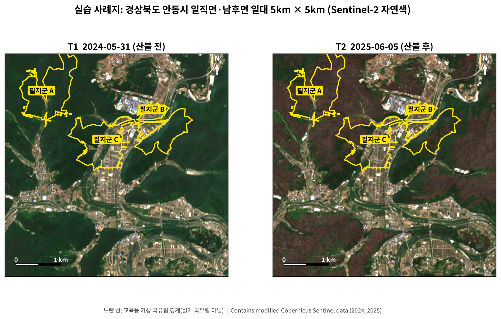

*그림 1. 실습 사례지. 왼쪽은 산불 전(2024-05-31), 오른쪽은 산불 후(2025-06-05)입니다. 오른쪽 영상의 적갈색 산지가 산불 피해지입니다. 노란 선은 교육용 가상 국유림 경계(필지군 A·B·C)입니다.*

### 🛰️ 사용 영상

| 구분 | 취득일 | 용도 | 처리 기준판 | 사례지 안 유효화소 |
|---|---|---|---|---|
| T1 | 2024-05-31 | 변화 전(산불 전, 봄) | 05.10 | 99.5% |
| T2 | 2025-06-05 | 변화 후(산불 후, 같은 계절) | 05.11 | 99.3% |
| T0 | 2024-11-07 | 계절 차이 오탐 설명용(강사 시연) | 05.11 | 97.3% |

- 세 영상 모두 같은 위성(Sentinel-2B)·같은 궤도(R003)에서 찍어 촬영 조건이 비슷합니다.
- 세 영상 모두 제품 정보(메타데이터)에서 반사율 보정값이 `BOA_ADD_OFFSET = −1000`, `QUANTIFICATION_VALUE = 10000` 임을 확인했습니다(5장에서 설명).

### 📦 실습 패키지 구성

수강생이 원본 영상(장당 약 0.94GB)을 동시에 내려받으면 교육장 네트워크가 감당하기 어렵습니다. 그래서 실습에는 사례지 크기로 잘라 둔 파일(패키지 전체 약 18MB)을 사용하고, 원본 조회·다운로드는 강사가 시연합니다.

```
forest_rs\
 ├ 00_project\   실습_프로젝트.qgz          ← 이 파일을 열면 레이어가 준비되어 있음
 ├ 01_image\     S2_T1_20240531_B04/B08/TCI/SCL10m.tif
 │               S2_T2_20250605_B04/B08/TCI/SCL10m.tif
 │               유효화소마스크.tif
 ├ 02_vector\    AOI, 교육용_가상국유림, 연속지적도_AOI, 임상도_AOI,
 │               후보지_템플릿, 원인판독점_강사
 ├ 03_backup\    백업_실습1, 백업_실습2, 백업_실습3   ← 단계별 완성본
 ├ 04_extra\     S2_T0_20241107_B04/B08/TCI.tif   ← 계절 비교 심화용
 └ output\       (수강생 결과 저장 폴더)
```

| 파일 | 내용 | 좌표계 | 구분 |
|---|---|---|---|
| S2_T1_20240531_B04.tif / B08.tif | T1 적색·근적외 밴드(10m) | EPSG:32652 | 실제 자료 |
| S2_T1_20240531_TCI.tif | T1 자연색 영상(10m) | EPSG:32652 | 실제 자료 |
| S2_T1_20240531_SCL10m.tif | T1 장면분류(20m를 10m로 맞춤) | EPSG:32652 | 실제 자료(강사 전처리) |
| S2_T2_20250605_… | T2 영상(위와 같은 구성) | EPSG:32652 | 실제 자료 |
| 유효화소마스크.tif | 구름·그림자·물을 뺀 분석 가능 화소(1/0) | EPSG:32652 | 강사 전처리 |
| AOI.gpkg | 실습 범위 5km × 5km | EPSG:5186 | 교육용 |
| 교육용_가상국유림.gpkg | **가상** 관리 경계 3개 필지군(A·B·C) | EPSG:5186 | **가상 자료** |
| 연속지적도_AOI.gpkg | 사례지 연속지적도 10,968필지, `jimok`(지목) 필드 포함 | EPSG:5186 | 실제 자료(브이월드) |
| 임상도_AOI.gpkg | 사례지 임상도 106개 폴리곤, `FRTP_NM`(임상명) 필드 포함 | EPSG:5186 | 실제 자료(산림청) |
| 후보지_템플릿.gpkg | 실습 1 기록용 빈 점 레이어(속성 10개) | EPSG:5186 | 교육용 |
| 원인판독점_강사.gpkg | 실습 3에서 결합할 강사의 원인 판독 결과(59점) | EPSG:5186 | 교육용(판독 추정) |

🧭 **좌표계 원칙**

- 위성영상은 받은 좌표계(EPSG:32652, UTM 52N) 그대로 계산합니다. 좌표계를 바꾸면 화소가 다시 배열되며 값이 미세하게 달라지기 때문입니다.
- 벡터 자료와 면적 계산은 **EPSG:5186(Korea 2000 / Central Belt 2010)** 으로 통일합니다. 사례지에서 같은 폴리곤 면적을 EPSG:5186, EPSG:5187, EPSG:32652로 계산해 보니 차이는 0.13% 이내였습니다. 선별 목적에서는 무시할 수 있으나 보고서에는 계산 기준을 적습니다.
- 위경도(EPSG:4326)에서는 면적을 계산하지 않습니다. GPS용 파일만 EPSG:4326으로 저장합니다.

### 💻 소프트웨어

| 구분 | 권장 | 비고 |
|---|---|---|
| GIS | QGIS 3.44 LTR 또는 4.2 LTR | 교재의 모든 계산식과 도구는 **QGIS 3.44.12(LTR)** 에서 실행해 결과를 확인했습니다. QGIS 4.x에서는 메뉴 위치가 다를 수 있으나, 툴박스 검색 방식은 같습니다 |
| 웹브라우저 | Chrome 또는 Edge | Copernicus Browser, 국토정보플랫폼, 브이월드 접속 |
| 계정 | Copernicus Data Space 계정(무료) | 원본 다운로드 시 필요. 실습 중에는 필요 없음 |

### 🖥️ QGIS 화면 구성과 기본 조작 (실습 전 5분)

> 📷 **화면 캡처 자리 S-01** — QGIS 3.44 첫 화면에 실습_프로젝트.qgz를 연 상태. ①메뉴 막대 ②도구 막대 ③레이어 패널 ④지도 창 ⑤공간 처리 툴박스 ⑥상태 표시줄(좌표·축척·좌표계)에 번호 표시

| 위치 | 이름 | 이 교재에서 쓰는 일 |
|---|---|---|
| 맨 위 | 메뉴 막대 | `Raster(래스터)`, `Vector(벡터)`, `Project(프로젝트)` 메뉴 |
| 왼쪽 | Layers(레이어) 패널 | 레이어 켜고 끄기, 순서 바꾸기, 오른쪽 클릭 메뉴 |
| 가운데 | 지도 창 | 영상과 경계 보기, 점 찍기 |
| 오른쪽 | Processing Toolbox(공간 처리 툴박스) | 도구 이름으로 검색해 실행 |
| 맨 아래 | 상태 표시줄 | 마우스 위치 좌표, 축척, 프로젝트 좌표계(EPSG) |

🖱️ **자주 쓰는 조작 다섯 가지**

1. **툴박스 열기**: 메뉴 `Processing(공간 처리) > Toolbox(툴박스)` 또는 `Ctrl + Alt + T`. 툴박스 위쪽 검색창에 도구 이름(예: `sieve`)을 입력하면 바로 찾을 수 있습니다. **메뉴 위치가 기억나지 않을 때는 언제나 툴박스 검색을 쓰십시오.**
2. **레이어 확대**: 레이어 패널에서 레이어를 오른쪽 클릭 > `Zoom to Layer(레이어로 확대)`.
3. **값 확인**: 도구 막대의 `Identify Features(피처 식별)`(i 모양 아이콘)를 누르고 지도를 클릭하면 그 지점의 값·속성이 오른쪽 창에 나옵니다.
4. **속성 테이블**: 레이어 오른쪽 클릭 > `Open Attribute Table(속성 테이블 열기)` 또는 `F6`.
5. **레이어 표현(색) 바꾸기**: 레이어를 더블클릭 > `Symbology(심볼)` 탭.

> 💡 **메뉴 이름 표기**: 이 교재는 메뉴를 `영문(한국어)` 형식으로 적습니다. 한국어판 QGIS의 번역어는 버전에 따라 조금 다를 수 있으니, 다르면 영문 이름이나 툴박스 검색으로 찾으십시오.

---

# 🌲 1장. 산림행정과 위성영상

## ❓ 1.1 산림행정에서 위성영상이 필요한 이유  `📖 자습`

| 행정 과제 | 기존 방식의 한계 | 위성영상이 보완하는 점 |
|---|---|---|
| 국유림 무단점유 확인 | 민원·순찰에 의존, 오지·대면적 관리 곤란 | 넓은 지역에서 "과거엔 숲이었는데 지금은 아닌 곳"을 먼저 추려냄 |
| 벌채·산지전용 이행 점검 | 허가 구역 경계 준수 여부를 현장에서만 확인 | 허가 경계와 실제 변화 범위를 겹쳐 비교 |
| 산불 피해 파악 | 접근 곤란, 피해 범위 산정에 시간 소요 | 피해 직후 영상으로 피해 범위를 빠르게 추정 |
| 복원·조림 모니터링 | 해마다 현장조사 비용 발생 | 같은 지점의 식생 회복을 매년 같은 기준으로 비교 |
| 산사태·병해충 | 발생 위치 파악 지연 | 급격한 식생 감소 지점 탐지 |

## ⚖️ 1.2 위성영상의 역할과 한계: "선별 도구"  `🎓 수업`

```
 넓은 관리구역 (수천~수만 ha)
        │  위성영상 분석 (저비용, 반복 가능)
        ▼
 변화 후보지 (수십 곳)            ← 사례지 5km×5km: 483곳
        │  고해상도 영상·항공사진으로 정밀 판독
        ▼
 현장조사 대상 (수 곳)            ← 사례지 가상 경계 안: 1·2순위 4개 조각
        │  현장 확인 + 지적·소유·허가기록 대조
        ▼
 행정 판단 (무단점유 여부, 조치)
```

위성영상이 알려 주는 것은 **"이 지점의 지표면이 두 시기 사이에 바뀌었다"** 는 사실까지입니다. 그것이 무단점유인지, 허가받은 사업인지, 자연적 변화인지는 영상만으로 판단할 수 없습니다.

## ☀️ 1.3 광학 위성영상의 기본 원리  `🎓 수업`

광학 위성은 햇빛이 지표면에 반사된 빛을 파장대(밴드)별로 나누어 기록합니다.

- **반사율(Reflectance)**: 들어온 빛 중 되돌아간 빛의 비율(0~1). 위성영상 분석의 기본 값입니다.
- **건강한 식생**은 광합성을 위해 적색광을 흡수하고, 잎 내부 구조 때문에 **근적외선(NIR, 사람 눈에 보이지 않는 빛)을 강하게 반사**합니다. 숲이 사라지면 근적외 반사가 줄고 적색 반사가 늘어납니다. 이 차이가 5장에서 다룰 NDVI의 원리입니다.
- 산불 피해지는 근적외 반사가 크게 줄고 단파적외(SWIR) 반사가 상대적으로 높아집니다.
- 광학 영상은 **구름을 뚫지 못하고**, 밤에는 찍지 못합니다. 장마철에는 쓸 수 있는 영상이 크게 줄어듭니다.

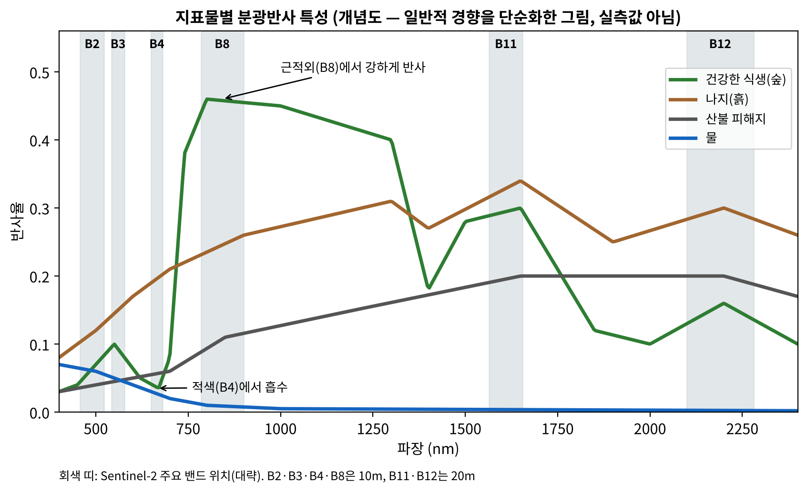

*그림 2. 지표물별 분광반사 특성 개념도. 일반적 경향을 단순화해 그린 것으로 실측값이 아닙니다. 숲(초록)은 적색(B4)에서 낮고 근적외(B8)에서 높습니다.*

## 📂 1.4 산림행정 활용 사례 유형  `📖 자습`

아래는 위성영상을 쓸 수 있는 **업무 유형**을 정리한 것이며, 특정 기관의 실적을 뜻하지 않습니다.

| 사례 유형 | 영상에서 보이는 징후 | 권장 해상도 | 영상 판독의 한계 |
|---|---|---|---|
| 산림 내 경작지 조성 | 숲 → 규칙적 경계의 밝은 나지 → 작물 패턴 | 10m(0.1ha 이상), 소규모는 1m 이하 | 허가받은 경작지와 구별 불가 |
| 건축물·컨테이너 설치 | 지붕 반사(매우 밝음), 직선 형태 | 1m 이하 고해상도 필요 | 10m 영상에서는 대부분 식별 불가 |
| 진입로 개설 | 숲 사이 선형의 밝은 띠 | 폭 3~5m 도로는 1m 내외 필요 | 기존 임도와 구별하려면 과거 영상 필요 |
| 무단 벌채 | 숲 → 나지, 경계가 직선적 | 10m로 탐지 가능 | 허가 벌채와 구별 불가 |
| 하천·도로변 정비 | 하천·도로를 따라 길게 이어지는 띠 모양 변화 | 10m로 탐지 가능(폭 수십 m 이상) | 공사 주체·허가 여부는 영상으로 알 수 없음 |
| 산불 피해 | 넓은 범위 식생 급감, 불규칙 경계 | 10~30m | 피해 강도 구분은 별도 지수 필요 |
| 복원 모니터링 | 나지 → 초본 → 관목, 점진적 증가 | 10~30m, 여러 해 비교 | 수종·생존율은 현장조사 필요 |

---

# 🛰️ 2장. 위성영상의 이해와 데이터 선택

## 🔭 2.1 해상도의 네 가지 의미  `🎓 수업`

| 해상도 | 의미 | 쉬운 설명 | 산림행정 예 |
|---|---|---|---|
| 공간해상도 | 한 화소가 나타내는 지상 크기 | "얼마나 작은 것까지 보이나" | 10m: 0.1ha 벌채지 탐지 가능 / 컨테이너 식별 불가 |
| 시간해상도 | 같은 지점을 다시 찍는 주기 | "얼마나 자주 찍나" | 5일 주기라도 구름 때문에 쓸 수 있는 영상은 한 달에 1~2장일 수 있음 |
| 분광해상도 | 기록하는 파장대의 수와 폭 | "어떤 빛을 구분하나" | 근적외·단파적외 밴드가 있어야 식생·연소 분석 가능 |
| 방사해상도 | 밝기를 몇 단계로 기록하나 | "명암을 얼마나 세밀하게" | 그림자 속 식생 구분에 영향 |

**화소 크기와 판독 가능한 대상 (경험적 기준)**

대상물이 화소 크기의 **2~3배 이상**이어야 형태를 안정적으로 판독할 수 있다는 것이 일반적인 판독 경험칙입니다. 대상과 주변의 밝기 차이에 따라 달라집니다.

| 화소 크기 | 1화소 면적 | 안정적 판독이 가능한 대상(경험칙) |
|---|---|---|
| 30m (Landsat) | 900㎡ | 수 ha 이상의 벌채·산불 피해 |
| 10m (Sentinel-2) | 100㎡ | 약 0.1~0.3ha 이상의 벌채·개간 |
| 5m 내외 (농림위성) | 25㎡ | 소규모 개간지, 넓은 진입로 |
| 0.5m 내외 (국토위성 등) | 0.25㎡ | 건축물, 컨테이너, 비닐하우스, 차량 |

## 🛰️ 2.2 주요 위성 비교  `📖 자습`

| 구분 | Sentinel-2 | Landsat 8/9 | 고해상도 국가·상용 위성 |
|---|---|---|---|
| 운영 | 유럽연합 Copernicus / ESA | 미국 USGS / NASA | 각국 정부(예: 국토위성, 다목적실용위성), 민간 기업 |
| 공간해상도 | 10m / 20m / 60m(밴드별) | 다중분광 30m, 전정색 15m | 0.3~3m 내외(위성별 상이) |
| 재방문 주기 | 2기 운용 시 약 5일 | 위성별 16일, 2기 조합 시 약 8일 | 위성·주문 조건에 따름 |
| 자료 기간 | 2015년 이후 | 1972년 이후(Landsat 계열 전체) | 위성별 상이 |
| 비용 | 무료 | 무료 | 대부분 유료. 국가 위성은 공공기관 공급 절차 있음 |
| 장점 | 무료 자료 중 가장 세밀, 적색경계 밴드 | 50년 이상의 장기 기록 | 소규모 시설물 식별 |
| 한계 | 소규모 시설물 식별 곤란 | 소규모 변화 탐지 곤란 | 비용, 이용 제약, 촬영 빈도 |
| 산림행정 권장 용도 | 연 단위 벌채·개간·피해 1차 선별 | 2015년 이전 과거 변화 추적 | 후보지 정밀 판독, 증빙 보조 |

🇰🇷 **국내 위성 참고**: 국토위성(차세대중형위성) 영상은 흑백 0.5m·컬러 2m급으로 공공기관에 공급되고 있습니다. 2026년 7월 7일 발사된 농림위성(차세대중형위성 4호)은 5m 해상도·120km 관측폭으로 한반도를 3일 주기로 관측하도록 설계되었고, 초기 운영 후 2027년부터 본격 임무를 수행할 예정입니다. 영상 공급 방식은 운영 개시 후 산림청 안내를 확인하십시오.

## 🌈 2.3 Sentinel-2 밴드 구성  `📖 자습`

| 밴드 | 이름 | 해상도 | 주 용도 |
|---|---|---|---|
| B02 | 청색 | **10m** | 자연색 합성 |
| B03 | 녹색 | **10m** | 자연색 합성 |
| B04 | 적색 | **10m** | 자연색 합성, **NDVI** |
| B08 | 근적외(NIR) | **10m** | **NDVI**, 식생 활력 |
| B05·B06·B07 | 적색경계(Red Edge) | 20m | 식생 스트레스 |
| B8A | 협대역 근적외 | 20m | 식생 분석 |
| B11·B12 | 단파적외(SWIR) | 20m | 연소지, 토양·수분 |
| B01·B09 | 연안 에어로졸, 수증기 | 60m | 대기보정 보조 |
| SCL | 장면분류 레이어 | 20m | 구름·그림자 제외(마스킹) |
| TCI | 자연색 합성 영상 | 10m | 눈으로 판독 |

> 💡 **실무 포인트**: NDVI에 쓰는 B04와 B08은 **둘 다 10m** 라서 바로 계산할 수 있습니다. 구름 판별에 쓰는 SCL은 20m라서 10m 밴드와 함께 쓰려면 화소 크기를 맞춰야 합니다. 실습 패키지에는 강사가 10m로 맞춘 SCL(`SCL10m`)을 넣어 두었습니다.

## 📅 2.4 영상 취득시기 고르는 기준  `🎓 수업`

| 고려 요소 | 원칙 | 산림 분야 적용 |
|---|---|---|
| 계절 일치 | 비교하는 두 시기는 **같은 계절**로 맞춘다 | 5월 말 vs 6월 초. 5월과 11월을 비교하면 숲의 1/3이 "감소"로 잘못 잡힘(5장 실측) |
| 구름 | 관심 지역 안에 구름이 없는 영상 우선 | 장면 전체 운량(%)보다 **관심 지역 안의 구름**을 직접 확인 |
| 태양고도 | 겨울철은 산 그림자가 길다 | 북사면이 겨울 영상에서 어둡게 나와 오탐 유발 |
| 적설 | 겨울 영상은 눈 여부 확인 | 눈이 쌓이면 NDVI가 크게 낮아짐 |
| 업무 기준일 | 변화 발생 추정 시점 전후로 선택 | 민원 접수일, 허가일, 산불 발생일 전후 |

**국내 산지의 영상 선택 달력(일반적 경향)**

```
월   1  2  3  4  5  6  7  8  9  10 11 12
식생 ▁  ▁  ▂  ▅  █  █  █  █  ▇  ▅  ▂  ▁   (활엽수 잎 상태)
구름 낮 낮 중 중 중 높 높 높 중 낮 낮 낮   (장마철 7~8월 구름 많음)
권장       ○  ◎  ◎           ○  ○         (◎: 식생 비교 최적, ○: 조건부)
```

이 달력은 국내 기후의 일반적 경향이며 해마다, 지역마다 다릅니다. 이번 사례지에서도 5월 말과 6월 초에 구름 없는 영상을 찾을 수 있었습니다.

## 🏠 2.5 소규모 점유 시설을 Sentinel-2만으로 판독하기 어려운 이유  `🎓 수업`

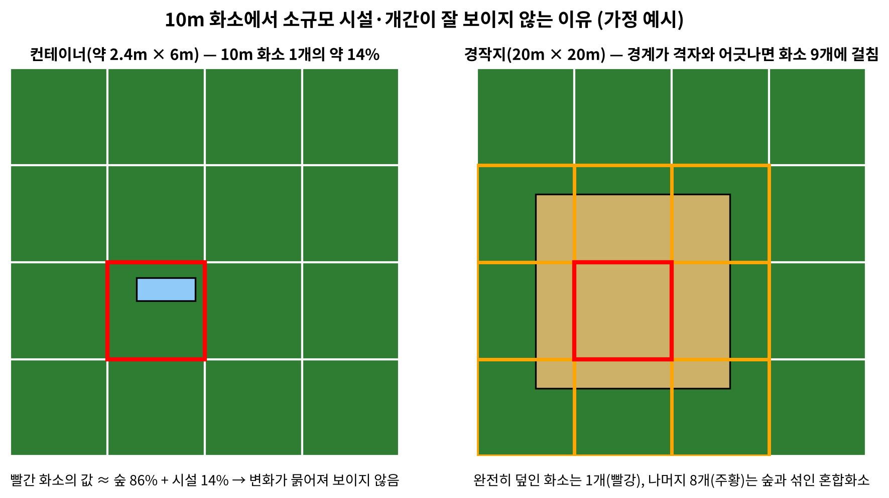

*그림 3. 10m 화소에서 소규모 시설·개간이 잘 보이지 않는 이유(가정 예시).*

- **혼합화소 문제**: 한 화소(100㎡) 안에 숲과 시설물이 섞이면 화소값은 둘의 평균에 가까워져 변화가 묽어집니다.
- **형태 판독 불가**: 사람이 "건물"이라고 알아보는 근거는 직선 모서리, 그림자, 지붕 색입니다. 10m 화소에서는 이런 형태 정보가 사라집니다.
- **결론**: Sentinel-2는 "이 근처에서 무언가 바뀌었다"는 **신호**를 줄 수 있지만, "이것이 시설물이다"라는 **판독**에는 1m 이하 영상이나 항공사진이 필요합니다. 실습 1에서는 국토정보플랫폼의 고해상도 영상을 함께 열람해 이 차이를 직접 확인합니다.

## 🧭 2.6 업무 목적별 자료 선택표  `📖 자습`

| 업무 질문 | 1차 선별 | 정밀 확인 | 비고 |
|---|---|---|---|
| 작년 대비 숲이 사라진 곳이 있는가? | Sentinel-2 NDVI 차분 | 항공사진, 고해상도 위성 | 같은 계절 비교 |
| 10년 전부터 언제 바뀌었는가? | Landsat 여러 해 비교 | 연도별 항공사진 | 2015년 이전은 Landsat |
| 컨테이너·건물이 생겼는가? | (Sentinel-2로는 신호 수준) | 0.5m급 영상, 항공사진 | 고해상도 필수 |
| 산불 피해 범위는? | Sentinel-2 NDVI·NBR 차분 | 드론, 현장조사 | 피해 강도는 NBR 계열 권장 |
| 벌채 허가 경계를 지켰는가? | Sentinel-2 + 허가 경계 중첩 | 고해상도 영상, 측량 | 경계부 10~20m는 오차 범위로 해석 |

---

# 📥 3장. 위성영상 조회 및 확보

## 🔗 3.1 공개 자료 출처 총괄표  `📖 자습`

아래 경로는 공개 자료와 공식 보도, 그리고 이번 실습 자료를 만들며 실제로 내려받은 경험으로 확인했습니다. 메뉴 구성과 가입 조건은 바뀔 수 있으니 이용 전에 다시 확인하십시오.

**① 어디서, 어떻게 받나**

| 자료 | 제공기관 | 접속 경로 | 가입·신청 |
|---|---|---|---|
| Sentinel-2 L1C/L2A | EU Copernicus / ESA | https://browser.dataspace.copernicus.eu/ | 조회 일부 가능, **다운로드는 무료 회원가입** |
| Landsat 8/9 Collection 2 | 미국 USGS | https://earthexplorer.usgs.gov/ | 다운로드 시 무료 회원가입 |
| 국토위성지도·항공사진·정사영상 | 국토교통부 국토지리정보원 | https://map.ngii.go.kr (국토정보플랫폼) | 웹 열람 가능, 파일 신청 절차는 자료별 확인 |
| 연속지적도 | 국토교통부 브이월드 | https://www.vworld.kr | 회원가입, 2D 데이터 API는 인증키 필요 |
| 임상도(1:25,000, 제5차) | 산림청 | https://map.forest.go.kr (산림공간정보서비스) | **다운로드 무료신청**(이용 목적·사유 입력) 후 내려받기 |
| 휴양림고시구역도 등 | 산림청 | https://www.data.go.kr/data/15158977/openapi.do | 공공데이터포털 회원·활용신청 |
| 산림보호구역 등 연속주제도(지자체 개방분) | 각 지자체 | 예: https://www.data.go.kr/data/15159371/fileData.do | 공공데이터포털 |

**② 형식과 이용조건**

| 자료 | 형식·해상도 | 좌표계 | 이용조건 |
|---|---|---|---|
| Sentinel-2 | SAFE 형식 zip(장면당 약 0.9GB), 10/20/60m | UTM(국내 51N·52N) | 무료. 출처 표기 "Contains modified Copernicus Sentinel data [연도]" |
| Landsat | GeoTIFF, 30m | UTM | 공공 영역, 출처 표기 권장 |
| 국토위성지도·항공사진 | 국토위성 정사영상 0.5m급, 항공사진 | 자료별 확인 | 자료별 이용조건 확인 |
| 연속지적도 | SHP 또는 API(JSON) | 요청 시 지정 | 공공데이터포털 표기상 공공누리 1유형(출처표시). 브이월드 약관 확인 필요 |
| 임상도 | SHP(시·도 단위) | 원본 EPSG:5179, 인코딩 EUC-KR | 산림청 안내상 비영리 공공사업·학술연구 목적, 민원 목적 이용 제한 |
| 휴양림고시구역도 | OpenAPI(XML) | 확인 필요 | 무료 |
| 지자체 연속주제도 | SHP | 파일별 확인 | 무료 |

⚠️ **홈페이지가 있다는 것과 실제로 받을 수 있다는 것은 다릅니다.** 업무에 쓰기 전에 다음을 확인하십시오.

1. 원하는 지역·시기의 자료가 실제로 있는가?
2. 열람만 되는가, 파일로 받을 수 있는가?
3. 좌표계와 해상도는 무엇인가?
4. 작성(촬영) 기준일은 언제인가?
5. 외부 공개·보고서 게재 시 출처 표기와 제약은 무엇인가?

🔎 **실습 자료를 만들며 확인한 주의점**

| 자료 | 알아 둘 점 |
|---|---|
| 연속지적도 | 지목이 별도 항목이 아니라 **지번 끝 글자**(예: "38대" → 대)로 들어 있습니다. 실습 패키지에서는 `jimok` 필드로 따로 분리해 두었습니다. 도면 갱신 기준일은 받은 자료에서 확인되지 않았습니다 |
| 임상도 | 원본 좌표계가 EPSG:5179이고 문자 인코딩이 EUC-KR입니다. 임상 코드 필드는 `FIFTH_FRTP`(D 소나무림, M 침활혼효림, H 활엽수림 등)입니다. 파일에 기준일 정보가 없습니다 |

### 🌲 국유림 경계 자료

국유림 경계와 소유·사용허가 정보는 공개 데이터포털에서 전국 단위 파일로 확인되지 않았습니다. 실무에서는 **소속 기관이 보유한 국유림 관리대장·지적 자료를 내부 절차에 따라** 사용하십시오. 이 교재의 실습은 **교육용 가상 국유림 폴리곤**을 사용하며, 실제 경계가 아닙니다.

토지 소유자 정보에는 개인정보가 포함될 수 있으므로 교육 자료나 외부 보고서에 그대로 옮기지 않습니다.

## 🛰️ 3.2 Copernicus Browser로 Sentinel-2 찾기  `🎓 시연`

**목적**: 원하는 지역·기간의 구름 적은 Sentinel-2 영상을 찾고, 미리 본 뒤 내려받습니다.

1. https://browser.dataspace.copernicus.eu/ 에 접속합니다. 다운로드가 필요하면 오른쪽 위에서 회원가입·로그인합니다.
2. 오른쪽 위 검색창에 지명(예: 안동시 일직면) 또는 좌표(위도, 경도)를 넣어 이동합니다.
3. 지도 오른쪽 도구 모음의 관심영역 그리기 도구로 사각형 또는 다각형을 그립니다.
4. 왼쪽 패널의 **Search(검색)** 탭에서 설정합니다.
   - 자료: Sentinel-2 → **L2A** (대기보정된 지표반사율)
   - 최대 운량(Max. cloud coverage): 예) 20%
   - 기간: 예) 2024-05-01 ~ 2024-06-15
5. 검색 결과의 날짜와 미리보기를 확인합니다. **장면 운량이 낮아도 관심 지역에 구름이 걸릴 수 있으므로** 지도에서 직접 확인합니다.
6. 후보 장면을 골라 자연색(True color)과 NDVI 시각화를 바꿔 봅니다.
7. 원본을 받으려면 결과 항목의 다운로드 아이콘을 누릅니다. zip으로 묶인 SAFE 폴더가 내려받아집니다(이번 T1 장면은 약 0.94GB).
8. 같은 방법으로 비교할 시기(예: 2025-05-15 ~ 2025-06-30)를 검색합니다.

> 📷 **화면 캡처 자리 S-02** — Copernicus Browser 검색 패널 — L2A 선택, 운량 슬라이더, 기간 입력란이 보이는 화면. 교육 직전 촬영

**원본 SAFE 폴더 구조(L2A, 요약)**

```
S2B_MSIL2A_20240531T021529_N0510_R003_T52SDF_20240531T042042.SAFE
 └ GRANULE
    └ L2A_T52SDF_...
       └ IMG_DATA
          ├ R10m   → B02, B03, B04, B08, TCI 등 (10m)
          ├ R20m   → B05~B07, B8A, B11, B12, SCL 등 (20m)
          └ R60m   → 60m 밴드
```

- 이름 속 `T52SDF`는 **타일 번호**(100km × 100km 격자), `N0510`은 **처리 기준판** 05.10입니다.
- QGIS에서는 각 밴드 파일(.jp2)을 레이어로 바로 불러올 수 있습니다(`Layer > Add Layer > Add Raster Layer`).
- 사례지 크기로 잘라 쓰려면 QGIS의 `Raster > Extraction > Clip Raster by Mask Layer(마스크 레이어로 래스터 자르기)`를 씁니다(부록 D).

> ❗ **중요: 화소값과 반사율** — 처리 기준판 04.00(2022년 1월 25일 도입) 이후 L2A 제품의 화소값(DN)에는 −1000의 보정값(오프셋)이 들어 있어 반사율은 `(DN − 1000) ÷ 10000`입니다. 사례지 영상 3장(기준판 05.10·05.11) 모두 제품 정보에서 이 값을 확인했습니다. NDVI 계산에 주는 영향은 5장에서 설명합니다.

## 🛰️ 3.3 USGS EarthExplorer로 Landsat 찾기  `📖 자습`

2015년 이전의 과거 변화를 확인할 때 씁니다.

1. https://earthexplorer.usgs.gov/ 에 접속해 무료 회원가입·로그인합니다.
2. 검색 조건 탭에서 지도에 관심 지역을 지정하고 날짜 범위를 넣습니다.
3. 데이터셋 탭에서 Landsat → Landsat Collection 2 Level-2(지표반사율)를 고릅니다.
4. 운량을 제한하고 결과를 확인합니다.
5. 미리보기로 구름을 확인한 뒤 내려받습니다.

**주의**: Landsat Collection 2 Level-2의 반사율 변환식은 Sentinel-2와 다릅니다(USGS 제품 안내 기준 `DN × 0.0000275 − 0.2`, 사용 전 제품 정보로 재확인). 두 위성의 NDVI를 섞어 비교하지 마십시오.

## 🇰🇷 3.4 국토정보플랫폼으로 고해상도 영상 보기  `📖 자습`

국토지리정보원은 국토정보플랫폼(map.ngii.go.kr)에서 국토위성 기반 영상지도를 웹으로 제공하며, 국토위성 정사영상의 해상도는 0.5m 수준으로 안내되어 있습니다. 2024년 2월 개편 때 '국토위성 영상비교', '우리동네 최신영상' 등이 추가되었다고 국토교통부가 발표했습니다.

1. 국토정보플랫폼에 접속해 영상지도(국토위성지도) 또는 항공사진 열람 메뉴로 이동합니다.
2. 사례지 지명(안동시 일직면 등)으로 이동합니다.
3. 영상비교 기능이 있으면 두 시기를 나란히 띄워 비교합니다.
4. 의심 지점의 형태(직선 경계, 지붕, 그림자, 도로)를 판독하고 촬영 시기를 적습니다.

> 📷 **화면 캡처 자리 S-03** — 국토정보플랫폼에서 사례지(실습 1 판독점 P01 부근)를 연 화면과 영상비교 메뉴 위치. 교육 직전 촬영

## 📝 3.5 위성영상 신청방법: 공개 자료와 국가 위성 자료  `🎓 요약 설명`

자료에 따라 **바로 내려받는 자료**와 **기관 신청이 필요한 자료**가 나뉩니다.

| 구분 | 자료 | 확보 방법 | 비고 |
|---|---|---|---|
| 즉시 다운로드 | Sentinel-2, Landsat | 회원가입 후 직접 다운로드(3.2~3.3절) | 개인 계정으로 가능 |
| 웹 열람 | 국토위성지도, 항공사진 | 국토정보플랫폼에서 열람(3.4절) | 원본 파일은 별도 신청 절차 확인 |
| 신청 후 다운로드 | 임상도 등 산림공간정보 | 산림공간정보서비스 무료신청(목적·사유 입력) | 이번 실습 임상도도 이 절차로 받음 |
| 기관 신청 | 국토위성(차세대중형위성) 영상 | 국토지리정보원(국토위성센터) 공급 절차 | 0.5m급. 중앙행정기관·지자체·공공기관에 공급되어 산림 관리 등에 쓰인다고 국토지리정보원이 밝힘 |
| 기관 신청 | 다목적실용위성(아리랑) 영상 | 영상 공급 기관의 공공기관 신청 절차 | 신청 창구·자격 확인 필요 |
| 향후 이용 | 농림위성(차세대중형위성 4호) 영상 | 산림청·농촌진흥청 공급 체계(운영 개시 후 안내 예정) | 5m, 3일 주기, 2027년부터 본격 임무 예정 |

**국가 위성영상 신청 때 확인할 항목**

1. 신청 자격: 소속 기관이 공공기관 공급 대상인가
2. 대상 지역·기간: 관심 지역 경계(SHP 등)와 원하는 촬영 기간
3. 자료 수준: 원본, 정사영상, 융합영상 등
4. 용도와 보안: 사용 목적, 보안 등급, 외부 공개 가능 여부
5. 신규 촬영 요청 가능 여부: 기존 영상 제공인지, 새로 찍어야 하는지
6. 소요 기간: 기존 영상과 신규 촬영의 처리 기간 차이

신청 서식과 창구는 바뀔 수 있으므로 실제 신청 전에 각 기관 누리집이나 소속 기관 공간정보 담당 부서에 확인하십시오. 국토지리정보원은 2025년 4월 국토위성 정보를 모은 국토위성센터 누리집을 열었다고 발표했습니다.

> 🔗 **사례지와의 연결**: 국토지리정보원은 2025년 3월 산불 당시 국토위성으로 의성 등 산불 지역을 촬영해 중앙행정기관과 지자체에 제공했다고 밝혔습니다. 실무에서는 무료 공개 영상(Sentinel-2)으로 범위를 먼저 파악하고, 필요한 지점만 국가 고해상도 영상을 신청해 정밀 판독하는 방식이 효율적입니다.

## 🔒 3.6 공간정보 보안 유의사항  `📖 자습`

- 고해상도 영상과 정밀 공간정보는 공개·비공개 구분과 보안 규정을 확인한 뒤 씁니다.
- 기관 신청으로 받은 영상은 **승인된 용도와 범위** 안에서만 쓰고, 외부 게재 전에 공개 가능 여부를 확인합니다.
- 국유림 관리대장, 점유자 정보처럼 개인정보가 들어 있는 자료는 분석 결과 파일과 분리해 관리합니다.
- 외부 웹서비스에 내부 자료(비공개 경계, 점유자 정보)를 올리지 않습니다.

## ©️ 3.7 라이선스와 출처 표기  `📖 자습`

| 자료 | 보고서·지도 표기 예 |
|---|---|
| Sentinel-2 | Contains modified Copernicus Sentinel data (2024, 2025) |
| Landsat | Landsat imagery courtesy of the U.S. Geological Survey |
| 국토정보플랫폼 영상 | 국토교통부 국토지리정보원 (자료명, 촬영연도) — 자료별 이용약관 확인 |
| 연속지적도 | 국토교통부 브이월드 (연속지적도, 조회일) |
| 임상도 | 산림청, 임상도(1:25,000, 제5차) |

상용 고해상도 영상은 구매 계약의 이용 범위(내부 업무용, 외부 공개 가능 여부)를 반드시 확인합니다.


---

# 🔍 4장. 실습 1: 국유림 무단점유 의심지역 탐색

## 📋 4.1 실습 개요

| 항목 | 내용 |
|---|---|
| 실습 목적 | 두 시기 자연색 영상과 관리 경계를 겹쳐 산림 안의 인위적 변화 징후를 찾고, 현장조사 후보지로 기록한다 |
| 완료 후 결과물 | ① 의심지점 점 레이어 `output\후보지_실습1.gpkg` (수업 중 2~3개) ② 지점별 판독 근거가 적힌 속성표 |
| 소요시간 | 40분 = 영상 찾기·신청 경로 시연 10분(3장) + 실습 30분 (🎓 단계 1·3·4·5, 📖 단계 2) |
| 사용 자료 | `00_project\실습_프로젝트.qgz` (T1·T2 자연색, 교육용_가상국유림, 연속지적도_AOI, 후보지_템플릿이 들어 있음) |
| 프로그램 | QGIS, 웹브라우저(국토정보플랫폼) |
| 완성본 | `03_backup\백업_실습1\후보지_실습1_완성본.gpkg` (강사 판독점 8개) |

⚠️ **주의사항**

- `교육용_가상국유림`은 **가상 경계**입니다. 실습에서 찾은 지점은 실제 무단점유와 무관하며, 결과물을 외부에 공유하지 않습니다.
- 연속지적도는 지적공부를 대신하지 않는 참고 도면입니다. 실제 경계와 수 m 이상 어긋날 수 있습니다.

## 🧭 4.2 판독의 기본 개념

**인위적 변화를 알아보는 단서**

| 변화 유형 | T1(과거) | T2(현재) | 판독 단서 | 10m 영상 탐지 |
|---|---|---|---|---|
| 경작지 조성 | 짙은 녹색 숲 | 밝은 갈색 나지, 규칙적 줄무늬 | 직선·직각 경계, 주변 농경지와 이어짐 | 0.1ha 이상 가능 |
| 건축물·시설 | 숲 | 매우 밝은 점, 청색·적색 지붕 | 직선 모서리, 그림자 | 대부분 불가 → 고해상도 |
| 진입로 | 숲 | 숲을 가르는 밝은 선 | 기존 도로·임도에서 이어짐 | 넓은 도로만 가능 |
| 벌채 | 숲 | 갈색 나지, 벌채 잔재 | 직선 경계, 고른 질감 | 가능 |
| 하천·도로변 정비 | 짙은 녹색 띠 | 갈색·회색 띠 | 하천·도로를 따라 길게 이어짐 | 폭 수십 m 이상이면 가능 |
| 산불·산사태 | 숲 | 적갈색·검은 사면, 계곡 따라 긴 나지 | 불규칙 경계, 지형 따라 분포 | 가능 |

**판독 확신도 기준(교육용 기준안)**

| 확신도 | 기준 |
|---|---|
| 상 | 두 시기 차이가 뚜렷하고, 고해상도 영상에서 인공 구조물·경작 흔적이 확인됨 |
| 중 | 두 시기 차이가 뚜렷하나 고해상도 확인을 못 했거나 원인 불명 |
| 하 | 차이가 약하거나 구름·그림자·계절·영농 주기 차이 가능성이 있음 |

**공간정보를 쓰기 전 확인 절차**

```
① 자료 기준일    → 연속지적도·임상도가 언제 기준인가?
② 좌표계        → 레이어 속성에서 좌표계 확인, 영상과 겹치는가?
③ 위치 정합      → 도로·하천 같은 뚜렷한 지물로 어긋남 확인
④ 지목·소유      → 지목은 연속지적도로 참고, 소유·점유허가는
                   반드시 기관 내부 공부와 허가기록으로 확인
⑤ 허가 이력      → 산지전용·일시사용·국유림 사용허가 여부(내부 자료)
```

## 🛠️ 4.3 실습 절차

### 1️⃣ 단계 1. 프로젝트 열기와 레이어 확인  `🎓 수업 4분`


1. 탐색기에서 `forest_rs\00_project\실습_프로젝트.qgz` 를 더블클릭합니다. (또는 QGIS에서 `Project(프로젝트) > Open(열기)`)
2. 왼쪽 레이어 패널에 다음 레이어가 있는지 확인합니다(위에서부터).
   - `후보지_템플릿` (빈 점 레이어)
   - `교육용_가상국유림` (노란 테두리)
   - `연속지적도_AOI` (필지 경계)
   - `임상도_AOI` (꺼져 있음)
   - `S2_T2_20250605_TCI` (켜져 있음, 2025년 자연색)
   - `S2_T1_20240531_TCI` (꺼져 있음, 2024년 자연색)
   - `AOI` (꺼져 있음)
3. 화면 오른쪽 아래 상태 표시줄에 **EPSG:5186** 이 보이는지 확인합니다. 영상은 EPSG:32652이지만 QGIS가 화면에서 자동으로 맞춰 보여 줍니다.
4. `교육용_가상국유림` 을 오른쪽 클릭 > `Zoom to Layer(레이어로 확대)`.

**예상 화면**: 2025년 자연색 영상 위에 노란 테두리의 필지군 A·B·C가 보입니다. 적갈색 산지가 산불 피해지입니다(그림 1의 오른쪽과 같은 모습).

> 📷 **화면 캡처 자리 S-04** — 실습_프로젝트.qgz를 연 직후 화면 — 레이어 패널 목록과 지도 창, 상태 표시줄의 EPSG:5186이 보이게

> 💡 연속지적도 필지선이 너무 촘촘해 영상이 가리면 `연속지적도_AOI` 의 체크를 잠시 끄십시오.

### 2️⃣ 단계 2. 위치가 맞는지 확인  `📖 시연 2분`

> 📖 강사가 한 곳에서 어긋남을 재어 보여 줍니다. 수강생은 보기만 하고 단계 3으로 넘어갑니다.

1. 도로나 하천처럼 뚜렷한 곳으로 확대합니다(마우스 휠).
2. `연속지적도_AOI` 를 켜고 도로·하천 필지 경계가 영상의 도로·하천과 맞는지 봅니다.
3. 어긋나 보이면 메뉴 `View(보기) > Measure(측정) > Measure Line(선 측정)` 으로 두 선 사이 거리를 재어 봅니다.

⚖️ **판단 기준**: 사례지에서는 임야 경계 기준으로 연속지적도와 영상의 차이가 대체로 1화소(10m) 이내였습니다. 지역에 따라 더 어긋날 수 있으므로, 경계선에서 10~20m 안쪽의 변화는 "경계부 불확실"로 기록합니다.

### 3️⃣ 단계 3. 두 시기 영상 비교  `🎓 수업 8분`

> 🎓 수업에서는 **방법 A(켜고 끄기)** 만 합니다. 방법 B는 자습, 방법 C(국토정보플랫폼)는 강사가 P01 한 곳을 시연합니다.

🅰️ **방법 A: 레이어 켜고 끄기 (기본)**

1. 레이어 패널에서 `S2_T2_20250605_TCI` 의 체크를 끄고 켜기를 반복하며 바로 아래의 `S2_T1_20240531_TCI` 와 번갈아 봅니다. (T1이 보이려면 T1의 체크가 켜져 있어야 합니다.)
2. 두 영상이 바뀌는 순간 색이 달라지는 곳을 찾습니다.

🅱️ **방법 B: 레이어 스와이프 플러그인 (선택)**

- QGIS 기본 기능에는 화면을 밀어 비교하는 도구가 없고 플러그인으로 설치합니다(`Plugins > Manage and Install Plugins` 에서 "swipe" 검색). 교육원 PC에서 설치가 허용되지 않으면 방법 A를 씁니다.

🌐 **방법 C: 국토정보플랫폼 고해상도 비교 (병행)**

1. 웹브라우저로 국토정보플랫폼(https://map.ngii.go.kr)에 접속합니다.
2. QGIS에서 의심 지점의 위치를 확인합니다. 상태 표시줄 좌표를 위경도로 보려면 상태 표시줄의 `EPSG:5186` 을 눌러 `EPSG:4326` 으로 바꾸면 됩니다(확인 후 다시 5186으로 돌려 놓으십시오).
3. 같은 위치를 국토정보플랫폼에서 찾아 건물·도로·경작 흔적을 판독하고, 영상 촬영 시기를 적습니다.

👁️ **찾아볼 것**

- 가상 경계 **안쪽**에서 T1에는 숲이었으나 T2에 나지·경작지·직선형 개간지로 바뀐 곳
- 경계 바깥 농경지가 경계 안쪽으로 **넓어진** 듯한 곳
- 숲을 가로지르는 새로운 선형 지물(진입로)
- **하천·도로를 따라 길게 이어지는 띠 모양 변화**(정비·공사·식생 제거 가능성)
- 산불 피해지 안에서 **직선 경계를 가진** 별도 변화(피해 후 벌채·작업로 가능성)

### 4️⃣ 단계 4. 의심지점 기록  `🎓 수업 12분`

> 🎓 수업에서는 **점 2~3개**를 목표로 합니다. 속성은 `cand_id`, `chg_type`, `confid`, `in_bound`, `note` 다섯 개만 채워도 됩니다. 나머지는 교육 후 업무에서 채우는 항목입니다.

📁 **먼저 기록용 레이어를 내 폴더에 복사합니다.** (원본 템플릿을 보호하기 위함)

1. `후보지_템플릿` 을 오른쪽 클릭 > `Export(내보내기) > Save Features As(다른 이름으로 피처 저장)`.
2. 설정
   - Format(형식): `GeoPackage`
   - File name(파일 이름): `...` 버튼을 눌러 `forest_rs\output\후보지_실습1.gpkg`
   - Layer name(레이어 이름): `후보지_실습1`
   - CRS(좌표계): `EPSG:5186`
   - `Add saved file to map(저장한 파일을 지도에 추가)` 체크
3. `OK` 를 누르면 레이어 패널에 `후보지_실습1` 이 생깁니다.

📍 **점을 찍고 속성을 입력합니다.**

4. 레이어 패널에서 `후보지_실습1` 을 선택합니다.
5. 도구 막대의 연필 모양 `Toggle Editing(편집 모드 전환)` 을 누릅니다.
6. `Add Point Feature(점 피처 추가)` 아이콘을 누르고 의심 지점의 가운데를 클릭합니다.
7. 속성 입력 창이 뜨면 아래처럼 입력하고 `OK` 를 누릅니다(`fid` 는 비워 두면 자동 입력).

| 필드명 | 입력 예 | 설명 |
|---|---|---|
| cand_id | P01 | 후보지 번호 |
| chg_type | 기타 | 경작지 / 시설물 / 진입로 / 벌채 / 자연변화 / 기타 |
| t1_date | 2024-05-31 | 비교 영상 T1 날짜 |
| t2_date | 2025-06-05 | 비교 영상 T2 날짜 |
| evidence | S2 자연색, 국토위성지도 | 판독 근거 영상 |
| confid | 중 | 상 / 중 / 하 |
| in_bound | 내부 | 가상 경계 내부 / 경계부 / 외부 |
| jimok | 답 | 연속지적도의 지목(참고) |
| note | 하천변 녹색 띠가 갈색 띠로 변함, 직선형 | 판독 소견 |
| field_req | Y | 현장확인 필요 여부 |

8. 3곳 이상 기록한 뒤 `Toggle Editing` 을 다시 누르고, 저장할지 묻는 창에서 `Save(저장)` 를 누릅니다.

**지목 확인 방법**: `Identify Features(피처 식별)` 도구로 `연속지적도_AOI` 필지를 클릭하면 오른쪽 창에 속성이 나옵니다. `jimok` 이 지목이고, `jibun` 끝 글자도 지목입니다(예: `38대` → 대). 여러 레이어가 겹쳐 있으면 식별 창 위쪽 `Mode(모드)` 를 `Current layer(현재 레이어)` 로 두고 레이어 패널에서 `연속지적도_AOI` 를 선택한 뒤 클릭하십시오.

> 📷 **화면 캡처 자리 S-05** — 점을 찍은 직후 뜨는 속성 입력 창(필드 10개)에 P01 예시값을 입력한 화면

### 5️⃣ 단계 5. 결과 공유  `🎓 수업 4분`


강사가 2~3명의 결과를 화면에 띄우고, 같은 지점을 서로 다르게 판독한 경우를 비교합니다. 이어서 강사 완성본(아래)과 비교합니다.

## 🧑‍🏫 4.4 강사 완성본: 사례지 판독점 8개

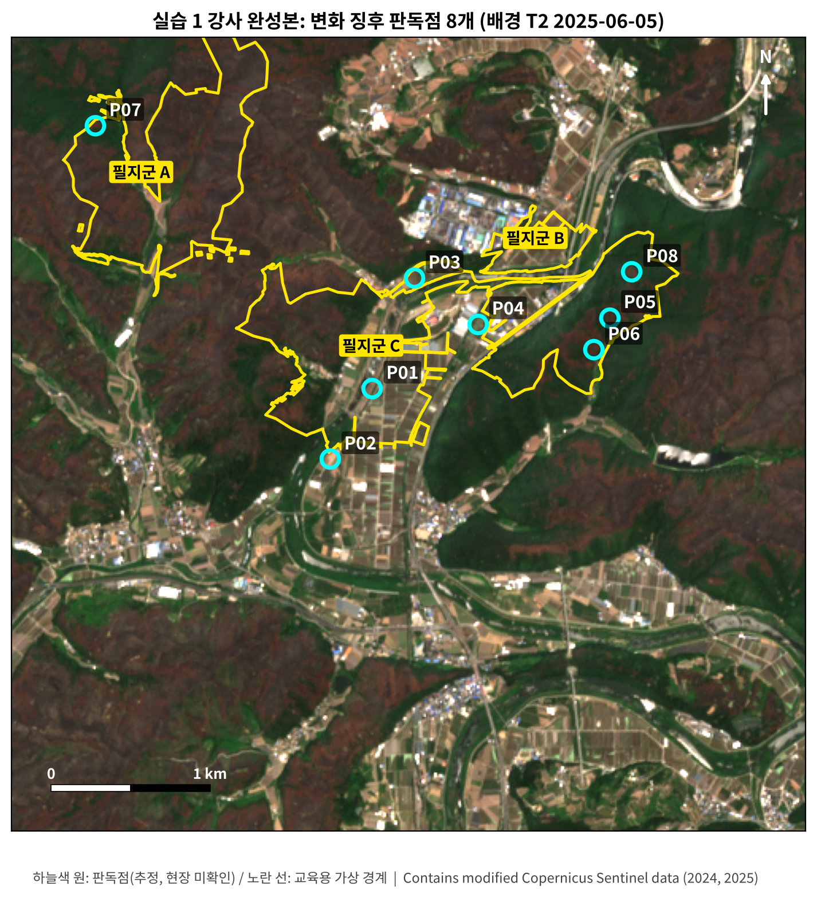

*그림 4. 강사 완성본 판독점(P01~P08). 판독은 10m 영상과 dNDVI를 함께 본 추정이며 현장에서 확인하지 않았습니다.*

| 번호 | 유형 | 확신도 | 경계 | 지목 | 판독 소견(요약) | 현장확인 |
|---|---|---|---|---|---|---|
| P01 | 기타 | 중 | 내부(C) | 답 | 하천변 선형 식생대가 갈색·회색 띠로 변함. 하천 정비·식생 제거 가능성(추정) | Y |
| P02 | 시설물 | 하 | 외부 | 전 | 농경지 안 소규모 직사각형 변화, 밝은 지붕형 반사. 10m 해상도로 판독 한계 | Y |
| P03 | 경작지 | 하 | 외부 | 답 | 소규모 필지 단위 색 변화. 작물 주기 차이 가능성(오탐 추정) | Y |
| P04 | 경작지 | 하 | 외부 | 답 | 시설재배·농경지 패치의 사각형 변화. 영농 주기 차이 추정 | N |
| P05 | 자연변화 | 중 | 내부(B) | 임 | 산림 내 불규칙 갈색 패치, 산불 잔존 패치 추정 | N |
| P06 | 자연변화 | 중 | 내부(B) | 임 | 산불 피해 경계부 패치 | N |
| P07 | 자연변화 | 상 | 내부(A) | 임 | 피해 사면 내부 대면적 변화, 산불 추정 | N |
| P08 | 벌채 | 하 | 내부(B) | 임 | 산림 내 소규모 패치. 산불 잔존과 구별 어려움 | Y |

🖼️ **판독 예시 세 가지**

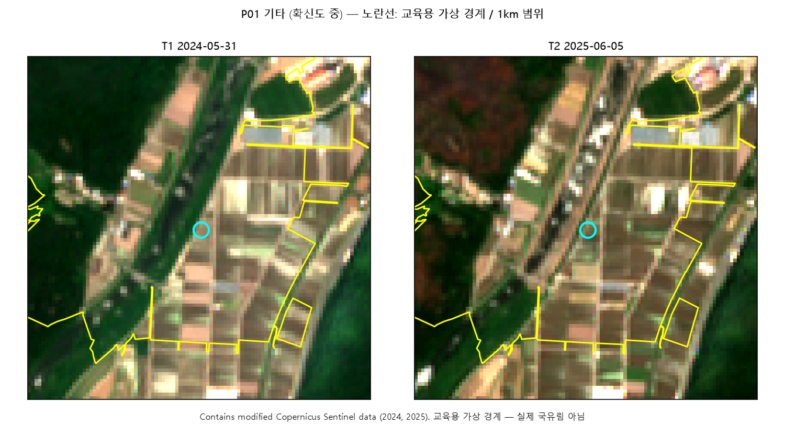

*그림 5. P01 — 하천변의 짙은 녹색 띠(T1)가 갈색·회색 띠(T2)로 바뀐 직선형 변화. 이번 사례지에서 산불과 구별되는 거의 유일한 직선형 변화입니다.*

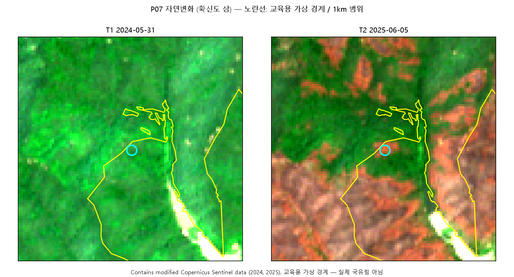

*그림 6. P07 — 사면 전체가 적갈색으로 바뀐 산불 피해. 경계가 불규칙하고 지형을 따라 퍼집니다.*

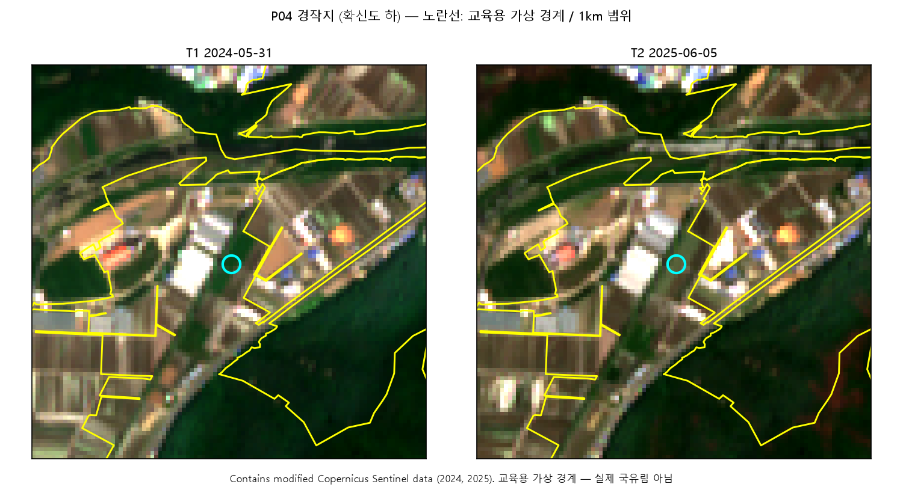

*그림 7. P04 — 농경지 안의 사각형 색 변화. 5월 말과 6월 초의 영농 시기 차이일 가능성이 높아 확신도를 '하'로 기록했습니다.*

## 🔎 4.5 결과 검증 방법

| 검증 항목 | 방법 |
|---|---|
| 위치 | 기록한 점이 변화 지역의 가운데에 있는가? T2 영상을 켜고 확인 |
| 경계 판정 | `in_bound` 값이 실제 경계와의 관계와 맞는가? |
| 오탐 배제 | 구름·그림자·영농 주기로 설명되지 않는가? |
| 근거 기록 | `evidence`, `note` 만 보고 다른 사람이 같은 판단을 할 수 있는가? |
| 완성본 대조 | `Layer > Add Layer > Add Vector Layer` 로 `03_backup\백업_실습1\후보지_실습1_완성본.gpkg` 를 불러와 비교 |

## ⚠️ 4.6 흔한 오류와 해결

| 증상 | 원인 | 해결 |
|---|---|---|
| 영상과 경계가 수백 m 이상 어긋남 | 레이어 좌표계가 잘못 지정됨 | 레이어 오른쪽 클릭 > `Layer CRS > Set Layer CRS` 에서 원래 좌표계(벡터 5186, 영상 32652) 지정 |
| 영상이 너무 어둡거나 하얗게 보임 | 표현 범위 문제 | 레이어 더블클릭 > `Symbology` > `Min/Max Value Settings` 에서 `Cumulative count cut 2~98%` 선택 |
| 점 찍기 아이콘이 회색 | 편집 모드가 아님, 또는 다른 레이어가 선택됨 | 레이어 패널에서 `후보지_실습1` 선택 후 `Toggle Editing` |
| 점이 저장되지 않음 | 편집 저장 누락 | `Toggle Editing` 을 끌 때 `Save` 선택 |
| 한글 속성이 깨짐 | 인코딩 불일치 | 레이어 속성 > `Source` 에서 인코딩을 UTF-8 또는 CP949로 변경 |
| 국토정보플랫폼에서 같은 곳을 못 찾음 | 좌표 형식 차이 | 상태 표시줄을 EPSG:4326으로 바꿔 위경도를 읽거나 강사가 안내한 지명 사용 |

## 💡 4.7 실무 해석

- 실습 1의 결과는 **"현장조사 후보지 목록"** 입니다. 무단점유를 판단한 결과가 아닙니다.
- 영상으로 알 수 있는 것은 "언제쯤(두 촬영일 사이), 어디서, 어떤 모양의 변화가 있었는가"까지입니다.
- 무단점유 여부를 판단하려면 다음이 **모두** 필요합니다.
  1. 소유 확인: 해당 필지가 국유림인가(지적공부, 국유림 관리대장)
  2. 허가 확인: 사용허가·대부·산지전용·일시사용 등 적법한 권원이 있는가
  3. 현장 확인: 실제 점유 행위, 시설 종류, 점유 범위, 점유자
  4. 경계 확인: 필요하면 지적측량으로 점유 범위 확정
- 문서에는 "무단점유지"가 아니라 **"변화 징후 지점", "현장확인 대상지"** 로 씁니다.

## ✅ 4.8 완료 체크리스트

- [ ] 상태 표시줄에서 프로젝트 좌표계가 EPSG:5186인지 확인했다
- [ ] 연속지적도와 영상의 어긋남을 대략 확인했다
- [ ] T1(2024-05-31)과 T2(2025-06-05)가 같은 계절임을 확인했다
- [ ] 템플릿을 `output\후보지_실습1.gpkg` 로 복사해 그 레이어에 기록했다
- [ ] 가상 경계 안·경계부에서 변화 징후 지점을 2~3개 기록했다
- [ ] 지점마다 변화 유형, 근거 영상, 확신도, 현장확인 필요 여부를 입력했다
- [ ] 1개 이상 지점을 국토정보플랫폼 고해상도 영상으로 교차 확인했다
- [ ] 영상만으로 무단점유를 확정할 수 없는 이유를 설명할 수 있다

---

# 🌿 5장. 산림 식생지수와 변화탐지 원리

## 🌿 5.1 NDVI(정규식생지수)  `🎓 수업`

**정의**: 근적외선과 적색광 반사율의 차이를 둘의 합으로 나눈 값입니다. 식생이 많고 활력이 높을수록 커지며 −1~1 사이 값을 가집니다.

```
          NIR − Red
 NDVI = ─────────────        Sentinel-2:  NIR = B08,  Red = B04 (둘 다 10m)
          NIR + Red
```

| NDVI 범위(일반적 경향) | 지표 상태 예 | 사례지 관측(평균) |
|---|---|---|
| 0.6 이상 | 울창한 숲(생장기) | 피해 없는 숲 0.86 |
| 0.3 ~ 0.6 | 성긴 숲, 초지, 자라는 농작물, 산불 직후 산지 | 산불 피해 숲(T2) 0.33 |
| 0.1 ~ 0.3 | 나지에 가까운 초지, 모내기 전후 논, 벌채지 | 논·밭 0.32, 마을·도로 0.32 (지점별 편차 큼) |
| 0 부근 이하 | 나지, 포장면, 지붕, 물(음수) | - |

위 범위는 일반적 경향이며 지역·계절·센서에 따라 달라집니다. 사례지 값은 실습 2에서 직접 확인합니다.

### 🧮 Sentinel-2 화소값의 보정값(오프셋)과 NDVI

Sentinel-2 L2A 화소값(DN)은 반사율에 10000을 곱하고 1000을 더한 값입니다. 따라서 반사율 = (DN − 1000) ÷ 10000이고, DN으로 NDVI를 계산할 때는 1000을 빼 주어야 합니다.

```
 올바른 계산:
          (B08 − 1000) − (B04 − 1000)          B08 − B04
 NDVI = ──────────────────────────────── = ─────────────────
          (B08 − 1000) + (B04 − 1000)        B08 + B04 − 2000
```

- 분자에서는 1000이 서로 지워지지만 **분모에서는 2000이 남습니다.**
- 사례지 숲 화소의 중간값(B08 약 4,850, B04 약 1,320)으로 계산하면 올바른 NDVI는 0.85, 2000을 빼지 않으면 0.57입니다.

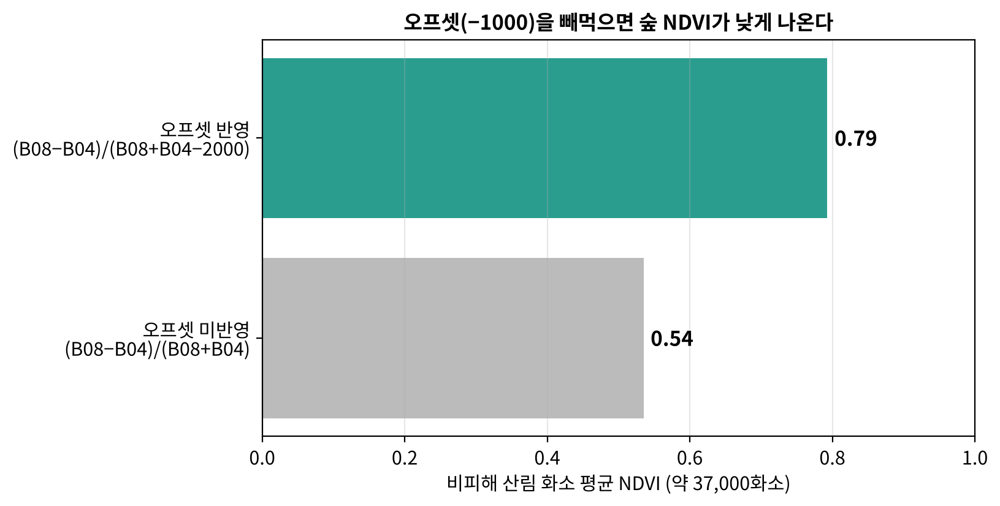

*그림 8. 사례지 피해 없는 산림 화소(약 37,000개)의 평균 NDVI. 보정값을 반영하지 않으면 숲이 실제보다 훨씬 성기게 보입니다.*

> 💡 이 교재의 NDVI 식은 **`(B08 − B04) / (B08 + B04 − 2000)`** 입니다. 사례지 영상 3장 모두 보정값이 −1000임을 제품 정보에서 확인했습니다. 다른 영상을 쓸 때는 제품 정보(`MTD_MSIL2A.xml` 의 `BOA_ADD_OFFSET`)를 확인하십시오.

### ⚠️ NDVI의 한계

| 한계 | 설명 | 산림행정 영향 |
|---|---|---|
| 포화 | 울창한 숲에서는 0.8~0.9 부근에서 더 오르지 않음 | 간벌 같은 미세한 변화는 탐지 어려움 |
| 계절성 | 활엽수는 낙엽기에 크게 떨어짐 | 다른 계절 비교 시 숲 전체가 "감소"로 오탐 |
| 토양 배경 | 식생이 성길 때 흙의 밝기 영향을 받음 | 벌채 후 풀이 자라면 변화가 작게 나타남 |
| 구름 | 구름은 NDVI를 낮추고 얇은 구름은 눈에 잘 띄지 않음 | 구름 제외(마스킹) 필수 |
| 지형 그림자 | 북사면·계곡은 값이 불안정 | 겨울 영상에서 특히 오탐 |
| 원인 구분 불가 | 낮아진 이유(벌채·산불·병해충·개간)를 알려 주지 않음 | 원인은 판독·현장확인으로 판단 |

## 🌿 5.2 변화탐지의 원리: NDVI 차분  `🎓 수업`

```
 dNDVI = NDVI(T2) − NDVI(T1)

   크게 음수 → 식생 감소 (벌채, 산불, 개간, 시설 설치, 정비 등)
   0 부근    → 변화 없음 (또는 탐지 한계 이하)
   크게 양수 → 식생 증가 (조림 생장, 휴경지 식생 회복, 작물 생육 등)
```

📊 **사례지 관측값 (각 10지점 평균, 강사 완성본)**

| 지점 | NDVI(T1) | NDVI(T2) | dNDVI | 해석 |
|---|---|---|---|---|
| 피해 없는 숲 | 0.86 | 0.85 | −0.01 | 변화 없음 |
| 산불 피해 숲 | 0.83 | 0.33 | −0.49 | 강한 감소 |
| 논·밭 | 0.32 | 0.34 | +0.02 | 평균은 변화 없음, 지점별 편차 큼(±0.16) |
| 마을·도로 | 0.32 | 0.32 | +0.01 | 변화 없음 |

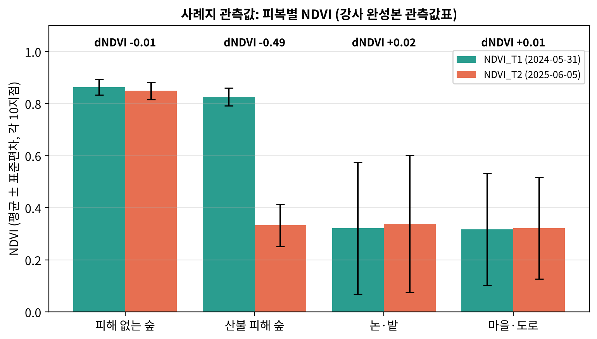

*그림 9. 사례지 피복별 NDVI(평균 ± 표준편차). 논·밭과 마을은 지점마다 값이 크게 달라 한 지점 값으로 판단하지 않습니다.*

### 🍂 계절 차이에 의한 오탐

사례지에서 **5월 말(T1)과 11월 초(T0)** 를 비교하자, 산불 피해가 없는 산림 화소의 **33%가 dNDVI −0.15 이하**로 "감소"에 걸렸습니다(평균 −0.10). 같은 계절인 5월 말과 6월 초(T1·T2)를 비교하면 그 비율은 **0.2%** 였습니다. 같은 계절끼리 비교하는 것이 가장 중요한 원칙인 이유입니다.

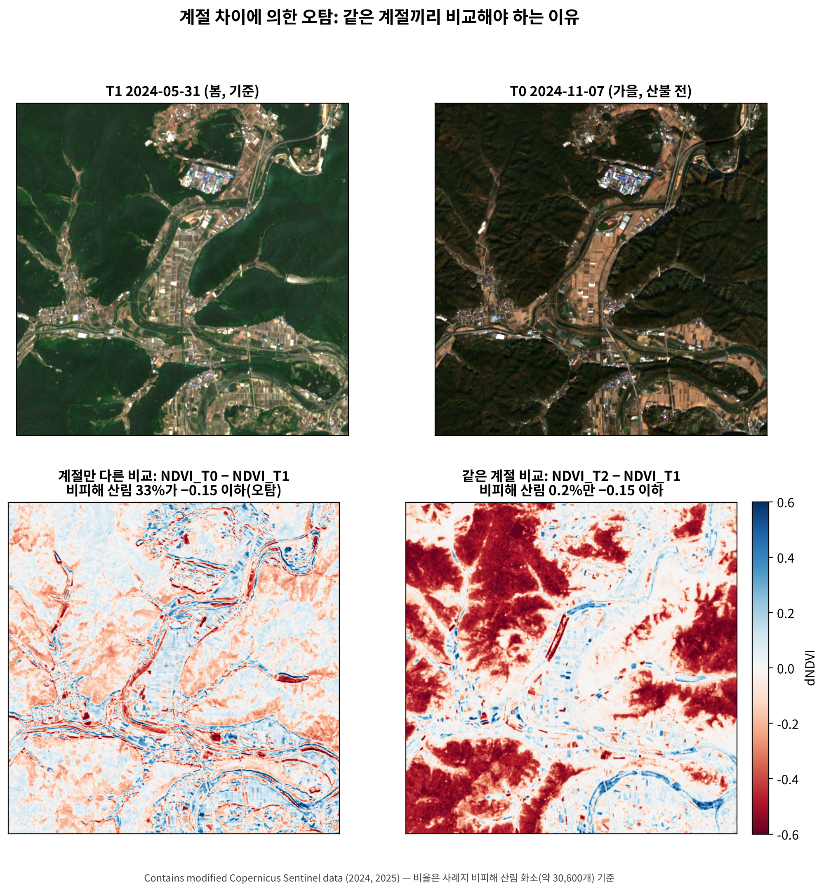

*그림 10. 왼쪽 아래는 계절만 다른 두 영상의 차이로, 산림 곳곳이 옅은 붉은색(감소)으로 나타납니다. 오른쪽 아래는 같은 계절 비교로, 짙은 붉은색은 실제 산불 피해입니다.*

## 🎚️ 5.3 임계값(Threshold) 정하기  `🎓 수업`

임계값은 "dNDVI가 얼마 이하이면 변화로 볼 것인가"를 정하는 기준입니다. **정답은 없으며**, 지역·계절·업무 목적에 맞게 정하고 근거를 기록해야 합니다.

| 방법 | 절차 | 장단점 |
|---|---|---|
| 고정 임계값 | 예) dNDVI ≤ −0.15 | 간단함 / 지역·시기에 따라 맞지 않을 수 있음 |
| 통계 기반 | 변화 없는 지역 dNDVI의 평균 − 2×표준편차 | 영상 조건에 맞춤 / 계산 단계 추가 |
| 표본 검증 기반 | 확실한 변화·비변화 지점 값을 보고 결정 | 근거가 명확 / 표본 판독 필요 |

**이 교재의 실습 설정**

| 등급 | dNDVI 범위 | 의미 |
|---|---|---|
| 2 강한 감소 | dNDVI ≤ −0.30 | 산불·벌채·개간 가능성 높음 |
| 1 감소 | −0.30 < dNDVI ≤ −0.15 | 확인 필요 |
| 0 변화 미미 | −0.15 초과 | 분석 대상에서 제외 |

📊 **사례지 검증 결과**

- 확실한 변화 30지점·확실한 비변화 30지점으로 확인한 결과, 임계값 −0.10~−0.30에서는 잘못 잡거나 놓친 표본이 없었고, −0.40에서는 변화 표본 2개(6.7%)를 놓쳤습니다.
- 다만 이 표본은 뚜렷한 변화·비변화 위주라 −0.10과 −0.30 사이의 차이를 가려내지는 못합니다. −0.15/−0.30은 "교육용 설정으로 무리 없음" 수준의 근거이며, 실무에서는 경계가 애매한 곳의 표본으로 따로 확인합니다.
- 같은 계절 비교에서 −0.15는 피해 없는 산림의 오탐을 0.2% 수준으로 억제했습니다.

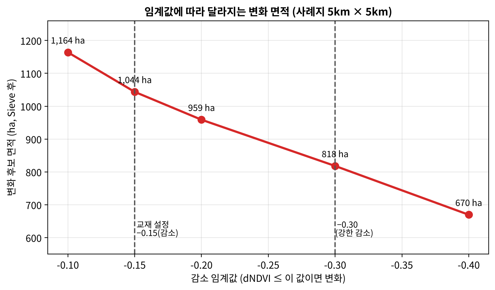

*그림 11. 임계값에 따라 달라지는 변화 후보 면적. −0.10이면 1,164ha, −0.40이면 670ha로 약 1.7배 차이가 납니다.*

임계값을 느슨하게(예: −0.10) 하면 작은 변화까지 잡히지만 오탐이 늘고, 엄격하게(예: −0.40) 하면 오탐은 줄지만 실제 변화를 놓칩니다. **업무 목적이 "놓치지 않기"(선별)이면 느슨하게, "확실한 것만"(보고)이면 엄격하게** 정합니다.

## 🔬 5.4 변화 원인을 구분하는 단서  `📖 자습`

| 원인 | dNDVI | 공간 형태 | 시간 특성 | 보조 확인 |
|---|---|---|---|---|
| 벌채 | 강한 감소 | 직선 경계, 블록형 | 특정 시점에 급변 | 벌채 허가 경계와 대조 |
| 산불 | 강한 감소 | 불규칙, 대면적, 사면·능선 따라 확산 | 발생일 전후 급변 | 산불 발생 기록, NBR 지수 |
| 개간·경작 | 감소 후 계절 따라 변동 | 직선·직각, 농경지와 이어짐 | 작물 주기에 따라 오르내림 | 고해상도 영상 |
| 하천·도로변 정비 | 감소 | 하천·도로를 따라 긴 띠 | 공사 시점에 급변 | 공사·정비 계획 확인 |
| 시설 설치 | 감소(소규모) | 작고 밝은 점 | 지속 | 고해상도 필수 |
| 계절 차이 | 숲 전체가 약하게 감소 | 활엽수림 전반 | 날짜 차이 | 같은 계절로 다시 비교 |
| 영농 주기 | 감소·증가가 섞임 | 필지 모양 사각형 | 모내기·수확 시기 | 지목(답·전) 확인 |
| 구름·그림자 | 급감 또는 급증 | 구름 모양, 산 그림자 | 해당 날짜만 | 장면분류(SCL) 확인 |

🔥 **보조 지수: NBR(정규연소지수)** — 산불 분석에는 근적외(B08)와 단파적외(B12)로 계산하는 NBR과 그 차이(dNBR)가 널리 쓰입니다. 사례지에서 dNBR로 잡은 피해 범위와 dNDVI로 잡은 감소 범위는 약 80% 일치했습니다. B12가 20m라 화소 크기를 맞추는 단계가 필요해 이 교육에서는 개념만 소개합니다(부록 D 심화).

```
 NBR = (B08 − B12) / (B08 + B12 − 2000)        dNBR = NBR(T1) − NBR(T2)
```

## ☁️ 5.5 구름·그림자 제외(마스킹): 장면분류 레이어(SCL)  `📖 자습`

Sentinel-2 L2A에는 화소마다 구름·그림자·식생·물 등을 구분한 **SCL(Scene Classification Layer)** 이 들어 있습니다. 구름을 가려내기 위한 보조 분류이며 정밀한 토지피복도가 아닙니다.

| SCL 값 | 분류 | 이 교재의 처리 |
|---|---|---|
| 0 | 자료 없음 | 제외 |
| 1 | 포화·결함 화소 | 제외 |
| 2 | 지형 그림자 | 제외 |
| 3 | 구름 그림자 | 제외 |
| 4 | 식생 | **사용** |
| 5 | 비식생(나지 등) | **사용** |
| 6 | 물 | 제외(하천·저수지 변화는 따로 해석) |
| 7 | 미분류 | **사용** |
| 8·9 | 구름(중간·높은 확률) | 제외 |
| 10 | 얇은 권운 | 제외 |
| 11 | 눈·얼음 | 제외 |

실습 패키지의 `유효화소마스크.tif` 는 **T1·T2 두 시기 모두 SCL이 4·5·7인 화소만 1**, 나머지는 0으로 만든 파일입니다. 사례지에서는 99.18%가 1이었고, 제외된 곳은 지형 그림자와 물이었습니다.

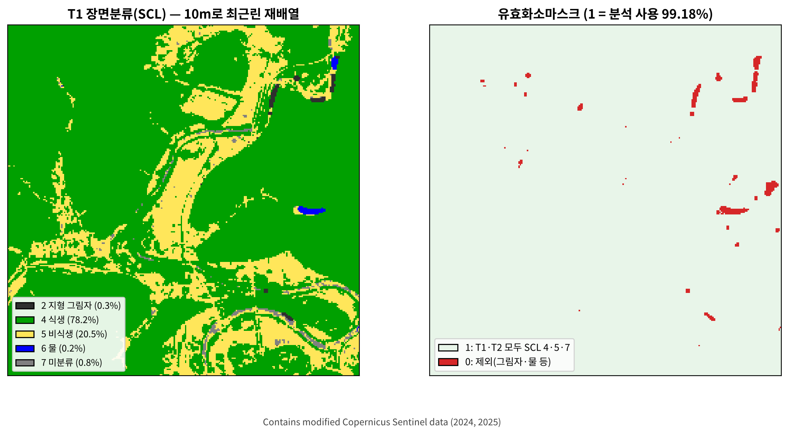

*그림 12. 왼쪽: T1 장면분류(SCL). 오른쪽: 유효화소마스크(빨강이 제외된 화소).*

**주의**: SCL은 20m입니다. 10m 밴드와 쓰려면 **최근린(Nearest Neighbour, 가장 가까운 원래 값을 그대로 쓰는 방식)** 으로 10m에 맞춰야 합니다. 평균을 내는 방식으로 맞추면 존재하지 않는 분류값이 생깁니다. SCL 자동 분류도 완벽하지 않으므로 마스킹 후에도 자연색 영상으로 눈으로 확인합니다.

## 🚨 5.6 오탐 사례 모음과 위치 오차  `🎓 수업`

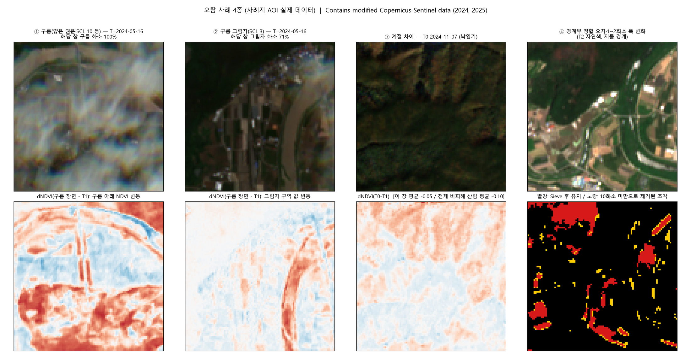

*그림 13. 사례지 실제 자료로 본 오탐 4종. ① 얇은 구름(2024-05-16 영상) ② 구름 그림자(같은 날) ③ 계절 차이(11월 영상) ④ 경계부 1~2화소 폭의 가는 변화(노랑: 10화소 미만이라 제거된 조각).*

- 두 시기 영상은 같은 격자로 제공되지만 화소 단위의 미세한 위치 차이가 있을 수 있습니다. 그래서 **경계선을 따라 1~2화소 폭으로 나타나는 가는 변화**는 실제 변화보다 위치 오차일 가능성이 높습니다.
- 실습 2에서는 **최소 탐지 면적(MMU) 0.1ha(10화소)** 를 적용해 이런 조각을 걸러냅니다.


---

# 📉 6장. 실습 2: 다중시기 위성영상 변화탐지

## 📋 6.1 실습 개요

| 항목 | 내용 |
|---|---|
| 실습 목적 | 두 시기 Sentinel-2 영상으로 NDVI와 dNDVI를 계산하고, 변화 후보지를 폴리곤으로 만들어 면적을 구한다 |
| 완료 후 결과물 | 수업: `NDVI_T1.tif`, `dNDVI.tif`, `변화등급.tif`, `변화폴리곤_전체.gpkg` / 자습까지: `변화후보지.gpkg`(면적·번호 포함) |
| 소요시간 | 55분 = 원리 10분(5장 🎓 절) + 실습 37분 + 오탐 점검·정리 8분 (🎓 단계 1~5·7, 📖 단계 6·8·9·10) |
| 사용 자료 | `01_image` 폴더의 T1·T2 `B04`, `B08`, `유효화소마스크.tif` |
| 프로그램 | QGIS (Raster Calculator, Sieve, Polygonize, 툴박스, 필드 계산기) |
| 완성본 | `03_backup\백업_실습2\` (단계별 산출물 전체) |

⚠️ **주의사항**

- 결과 파일은 모두 `forest_rs\output\` 에 저장합니다. 사례지 검증 PC(Windows 11, QGIS 3.44.12)에서는 한글 경로도 문제없었지만, PC 환경에 따라 오류가 날 수 있으므로 **폴더 경로는 영문**을 권장합니다.
- 영상 계산은 영상 원래 좌표계(EPSG:32652)에서 하고, 면적은 폴리곤을 EPSG:5186으로 바꾼 뒤 계산합니다.
- 어느 단계에서든 막히면 `03_backup\백업_실습2\` 의 같은 이름 파일을 불러와 다음 단계로 넘어가십시오.

## 🔀 6.2 작업 흐름

```
 T1_B04, T1_B08 ──▶ NDVI_T1 ─┐
                             ├──▶ dNDVI = NDVI_T2 − NDVI_T1        [래스터 계산기]
 T2_B04, T2_B08 ──▶ NDVI_T2 ─┘          │
                                         ▼
 MASK(유효화소마스크) ──────────▶ 변화등급 (0 제외, 1 감소, 2 강한 감소)   [래스터 계산기]
                                         │
                                         ▼ Sieve: 10화소(0.1ha) 미만 제거, 8방향   [Raster 메뉴]
                                         │
                                         ▼ Polygonize: 폴리곤으로 변환, 8방향        [Raster 메뉴]
                                         │
                                         ▼ 등급>0만 추출 → EPSG:5186 → 면적(ha)·번호  [툴박스·필드 계산기]
                                   변화후보지.gpkg
```

## 🛠️ 6.3 실습 절차

### 1️⃣ 단계 1. 밴드 불러오기와 이름 바꾸기  `🎓 수업 3분`


1. 메뉴 `Layer(레이어) > Add Layer(레이어 추가) > Add Raster Layer(래스터 레이어 추가)` 를 엽니다.
2. `Source(소스)` 오른쪽 `...` 버튼을 눌러 `01_image` 폴더에서 다음 5개 파일을 `Ctrl` 을 누른 채 함께 고르고 `Add(추가)` 를 누릅니다.
   - `S2_T1_20240531_B04.tif`, `S2_T1_20240531_B08.tif`
   - `S2_T2_20250605_B04.tif`, `S2_T2_20250605_B08.tif`
   - `유효화소마스크.tif`
3. 레이어 이름을 짧게 바꿉니다. 레이어를 오른쪽 클릭 > `Rename Layer(이름 바꾸기)`.

| 원래 이름 | 바꿀 이름 |
|---|---|
| S2_T1_20240531_B04 | `T1_B04` |
| S2_T1_20240531_B08 | `T1_B08` |
| S2_T2_20250605_B04 | `T2_B04` |
| S2_T2_20250605_B08 | `T2_B08` |
| 유효화소마스크 | `MASK` |

4. `Identify Features(피처 식별)` 로 숲을 클릭해 `T1_B08` 값을 봅니다. 수천 단위 정수(예: 4,800)라면 보정값이 들어 있는 원래 화소값(DN)입니다.

> 💡 이름을 바꾸는 이유: 래스터 계산기 수식이 레이어 이름을 그대로 쓰기 때문입니다. 아래 수식은 이 이름을 기준으로 합니다.

### 2️⃣ 단계 2. NDVI 계산  `🎓 수업 8분 (T1만)`

> 🎓 수업에서는 **NDVI_T1만 직접 계산**합니다. NDVI_T2는 `Layer > Add Layer > Add Raster Layer` 로 `03_backup\백업_실습2\NDVI_T2.tif` 를 불러옵니다(아래 6번은 자습).

1. 메뉴 `Raster(래스터) > Raster Calculator(래스터 계산기)` 를 엽니다.
2. 왼쪽 `Raster Bands(래스터 밴드)` 목록에서 `T1_B08@1` 을 한 번 클릭해 선택하고, 오른쪽 `Spatial Extent(공간 범위)` 의 `Use Selected Layer Extent(선택한 레이어 범위 사용)` 버튼을 누릅니다. → 범위와 해상도(500 × 500, 10m)가 원본과 같아집니다.
3. 설정값을 입력합니다.
   - `Output layer(출력 레이어)`: `...` → `forest_rs\output\NDVI_T1.tif`
   - `Output format(출력 형식)`: `GeoTIFF`
   - `Output CRS(출력 좌표계)`: `EPSG:32652`
   - `Add result to project(결과를 프로젝트에 추가)`: 체크
4. 아래 `Raster Calculator Expression(표현식)` 칸에 다음을 입력합니다. (밴드 이름은 목록에서 더블클릭하면 자동으로 들어갑니다.)

```
("T1_B08@1" - "T1_B04@1") / ("T1_B08@1" + "T1_B04@1" - 2000)
```

5. 아래쪽에 `Expression valid(수식 유효)` 가 보이면 `OK` 를 누릅니다.
6. 같은 방법으로 T2를 계산합니다. (범위는 `T2_B08@1` 선택 후 같은 버튼)
   - 출력: `forest_rs\output\NDVI_T2.tif`

```
("T2_B08@1" - "T2_B04@1") / ("T2_B08@1" + "T2_B04@1" - 2000)
```

> 📷 **화면 캡처 자리 S-06** — 래스터 계산기 대화상자에 NDVI_T1 수식·출력 경로·Use Selected Layer Extent 버튼 위치가 보이는 화면

🎨 **색 입히기**

7. `NDVI_T1` 을 더블클릭 > `Symbology(심볼)` 탭.
   - `Render type(렌더 유형)`: `Singleband pseudocolor(단일밴드 의사색상)`
   - `Min(최소)`: `0`, `Max(최대)`: `1`
   - `Color ramp(색상표)`: `RdYlGn` (빨강-노랑-초록)
   - `OK`
8. `NDVI_T2` 에도 같은 설정을 합니다. (요령: `NDVI_T1` 오른쪽 클릭 > `Styles > Copy Style` 후 `NDVI_T2` 오른쪽 클릭 > `Styles > Paste Style`)

👀 **예상 결과**: 숲은 초록, 산불 피해지·마을·논밭은 노랑~빨강으로 보입니다.

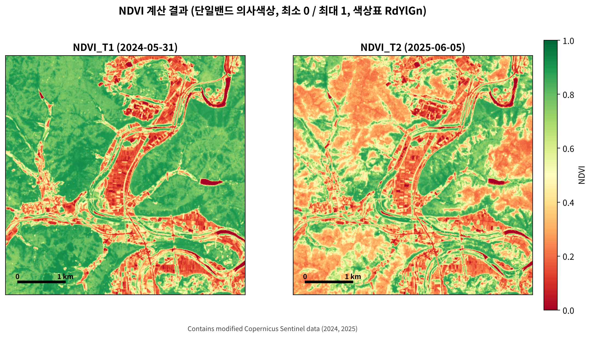

*그림 14. NDVI 계산 결과. T2에서 산불 피해 산지가 노랑~주황으로 바뀌었습니다.*

### 3️⃣ 단계 3. NDVI 값 확인  `🎓 수업 3분`

> 🎓 피해 없는 숲과 산불 피해 숲 두 곳만 확인해도 충분합니다.

1. `Identify Features` 로 아래 네 곳을 클릭해 `NDVI_T1`, `NDVI_T2` 값을 적습니다. (식별 창의 `Mode` 를 `Top down(위에서 아래로)` 로 두면 두 레이어 값이 함께 나옵니다.)

| 지점 | NDVI_T1 | NDVI_T2 | 내 메모 | 강사 관측(10지점 평균) |
|---|---|---|---|---|
| 피해 없는 숲 | | | | 0.86 → 0.85 |
| 산불 피해 숲 | | | | 0.83 → 0.33 |
| 논·밭 | | | | 0.32 → 0.34 (편차 큼) |
| 마을·도로 | | | | 0.32 → 0.32 (편차 큼) |

2. 숲의 NDVI가 0.6 미만으로 낮게 나오면 수식에서 `- 2000` 이 빠지지 않았는지 확인합니다(6.6절).

### 4️⃣ 단계 4. NDVI 차분(dNDVI) 계산  `🎓 수업 5분`


1. `Raster > Raster Calculator` 를 다시 엽니다.
2. `NDVI_T1@1` 을 선택하고 `Use Selected Layer Extent` 를 누릅니다.
3. 출력: `forest_rs\output\dNDVI.tif`, 표현식:

```
"NDVI_T2@1" - "NDVI_T1@1"
```

4. 색 입히기: `Singleband pseudocolor`, Min `-0.8`, Max `0.8`, Color ramp `RdBu`.

👀 **예상 결과**: 산불 피해지는 넓은 빨간 덩어리, 변화 없는 숲과 마을은 흰색에 가깝게 보입니다. 논·밭은 영농 시기 차이로 빨강·파랑이 섞입니다. 가운데 하천변에 **비스듬한 빨간 띠**가 보이는데, 실습 1의 P01(하천변 선형 변화)입니다.

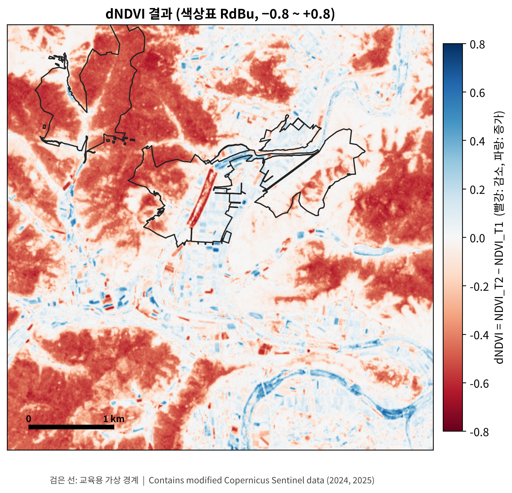

*그림 15. dNDVI 결과. 빨강은 식생 감소, 파랑은 증가입니다.*

### 5️⃣ 단계 5. 임계값 적용과 마스킹  `🎓 수업 6분`


1. `Raster > Raster Calculator` 를 열고 `dNDVI@1` 을 선택한 뒤 `Use Selected Layer Extent`.
2. 출력: `forest_rs\output\변화등급.tif`, 표현식:

```
( ("dNDVI@1" <= -0.30) * 2
  + ("dNDVI@1" > -0.30 AND "dNDVI@1" <= -0.15) * 1 ) * "MASK@1"
```

🧮 **수식 풀이**

- 괄호 안의 비교식은 참이면 1, 거짓이면 0이 됩니다.
- 강한 감소(−0.30 이하)는 2, 감소(−0.30 초과 ~ −0.15 이하)는 1, 나머지는 0입니다.
- 마지막에 `MASK`(사용 1, 제외 0)를 곱하면 구름·그림자·물 화소는 0이 됩니다.

3. 색 입히기: `Symbology` > `Render type`: `Paletted/Unique values(팔레트/고유값)` > `Classify(분류)` 를 누른 뒤 0은 체크 해제(투명), 1은 주황, 2는 빨강으로 색을 바꿉니다(색 칸을 더블클릭).

### 6️⃣ 단계 6. 작은 조각 제거: Sieve(체 거르기)  `📖 시연 3분`

> 📖 강사가 Sieve 대화상자(특히 **8방향 체크**)를 보여 줍니다. 수강생은 `03_backup\백업_실습2\변화등급_sieve.tif` 를 불러와 단계 7에 씁니다.

화소 한두 개짜리 변화는 위치 오차나 잡음일 가능성이 높으므로 없앱니다.

1. 메뉴 `Raster(래스터) > Analysis(분석) > Sieve(체 거르기)` 를 엽니다. (툴박스에서 `sieve` 검색도 같음)
2. 설정값
   - `Input layer(입력 레이어)`: `변화등급`
   - `Threshold(임계값)`: `10` (10화소 × 100㎡ = 1,000㎡ = **0.1ha**)
   - `Use 8-connectedness(8방향 연결 사용)`: **체크**
   - `Sieved(출력)`: `...` > `Save to File(파일로 저장)` > `forest_rs\output\변화등급_sieve.tif`
3. `Run(실행)` 을 누르고, 끝나면 `Close(닫기)`.
4. `변화등급_sieve` 에도 단계 5와 같은 색을 입히고, `변화등급` 과 번갈아 켜 보며 작은 점들이 사라졌는지 확인합니다.

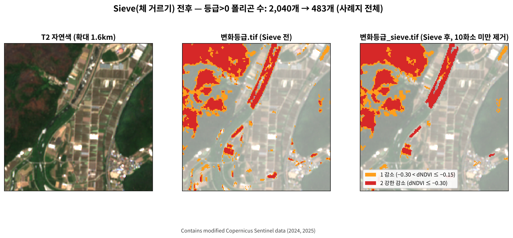

*그림 16. Sieve 전후. 논밭 사이의 작은 조각이 사라지고 산불 덩어리와 하천변 띠는 남습니다. 사례지 전체로는 등급 1·2 조각이 2,040개에서 483개로 줄었습니다.*

📏 **최소 탐지 면적(MMU) 0.1ha의 의미**: 이보다 작은 개간·시설은 이 분석에서 **탐지되지 않습니다.** 결과를 보고할 때 반드시 함께 적습니다.

### 7️⃣ 단계 7. 폴리곤으로 바꾸기: Polygonize(폴리곤화)  `🎓 수업 5분`

> 🎓 입력은 불러온 `변화등급_sieve` 입니다. **8방향 연결 체크**가 이 단계의 핵심입니다.

1. 메뉴 `Raster(래스터) > Conversion(변환) > Polygonize (Raster to Vector)(폴리곤화)` 를 엽니다.
2. 설정값
   - `Input layer`: `변화등급_sieve`
   - `Band number(밴드 번호)`: `Band 1`
   - `Name of the field to create(생성할 필드 이름)`: `grade`
   - `Use 8-connectedness(8방향 연결 사용)`: **체크 (단계 6과 같게)**
   - `Vectorized(출력)`: `forest_rs\output\변화폴리곤_전체.gpkg`
3. `Run`.

> ⚠️ **8방향 연결 옵션을 꼭 켜십시오.** 이 옵션은 기본값이 꺼져 있습니다. 사례지에서 켜지 않으면 폴리곤이 **1,963개**, 켜면 **483개**로 네 배 차이가 납니다. Sieve를 8방향으로 했으므로 폴리곤화도 8방향으로 맞춰야 조각 기준이 같아집니다.

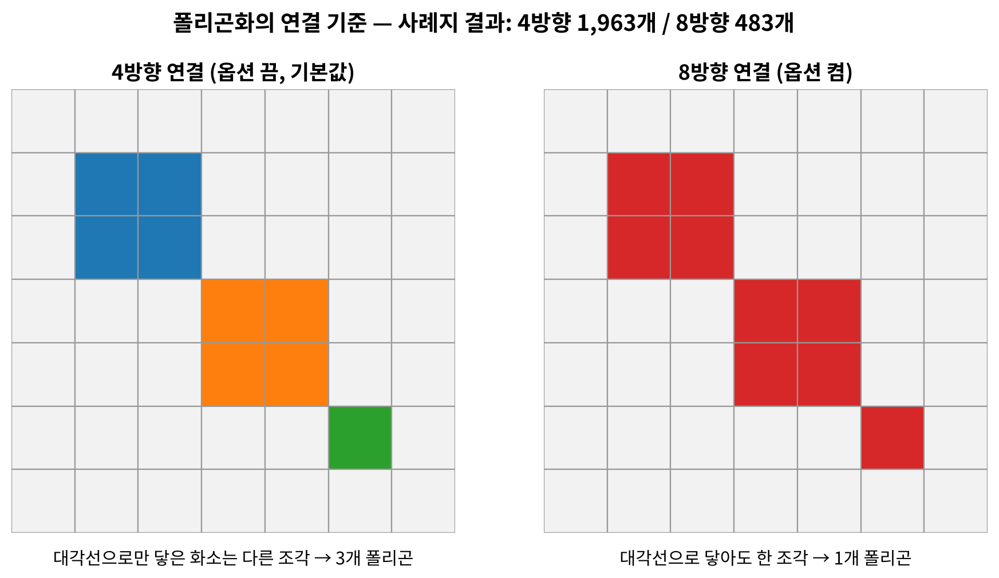

*그림 17. 연결 기준에 따른 조각 수 차이.*

### 8️⃣ 단계 8. 변화 폴리곤만 추출하고 좌표계 바꾸기  `📖 시연 2분`

> 📖 강사가 시연합니다. 결과물은 실습 3에서 `변화후보지_완성본.gpkg` 로 이어받습니다.

폴리곤화 결과에는 등급 0(변화 없음) 영역도 폴리곤으로 들어 있으므로 등급 1·2만 골라냅니다.

1. 툴박스(`Ctrl + Alt + T`) 검색창에 `extract by attribute` 를 입력하고 `Extract by attribute(속성으로 추출)` 를 더블클릭합니다.
   - `Input layer`: `변화폴리곤_전체`
   - `Selection attribute(선택 속성)`: `grade`
   - `Operator(연산자)`: `>`
   - `Value(값)`: `0`
   - `Extracted (attribute)(출력)`: `forest_rs\output\변화폴리곤_추출.gpkg`
   - `Run` → 483개가 나오면 정상입니다.
2. 메뉴 `Vector(벡터) > Data Management Tools(데이터 관리 도구) > Reproject Layer(레이어 재투영)` 를 엽니다.
   - `Input layer`: `변화폴리곤_추출`
   - `Target CRS(대상 좌표계)`: 오른쪽 지구본 버튼을 눌러 `5186` 검색 > `Korea 2000 / Central Belt 2010 (EPSG:5186)` 선택
   - `Reprojected(출력)`: `forest_rs\output\변화후보지.gpkg`
   - `Run`

### 9️⃣ 단계 9. 면적과 번호 넣기  `📖 시연 2분`

> 📖 필드 계산기는 실습 3에서 직접 써 봅니다. 여기서는 강사 시연만 봅니다.

1. `변화후보지` 를 오른쪽 클릭 > `Open Attribute Table(속성 테이블 열기)`.
2. 속성 테이블 위쪽의 주판 모양 `Open Field Calculator(필드 계산기 열기)` 를 누릅니다.
3. 면적 필드 설정
   - `Create a new field(새 필드 생성)`: 체크
   - `Output field name(출력 필드 이름)`: `area_ha`
   - `Output field type(출력 필드 유형)`: `Decimal number (real)(실수)`
   - `Precision(정밀도)`: `3`
   - 표현식: `area($geometry) / 10000`
   - `OK`
4. 다시 필드 계산기를 열어 번호 필드를 만듭니다.
   - `Output field name`: `chg_id`, 유형: `Text (string)(문자열)`, 길이 `10`
   - 표현식: `'C' || lpad(to_string(@row_number), 3, '0')`
5. 속성 테이블 첫 행의 `chg_id` 가 `C001` 인지 확인합니다. `C000` 으로 시작하면 4번을 `@row_number + 1` 로 다시 계산합니다.
6. 속성 테이블 위쪽 `Save edits(편집 저장)`(디스크 모양)를 누르고, 연필 아이콘으로 편집 모드를 끕니다.

❓ **왜 `area($geometry)` 인가?** `area($geometry)` 는 레이어 좌표계(EPSG:5186) 평면 기준 면적이고, `$area` 는 프로젝트의 타원체 설정에 따라 값이 달라질 수 있습니다. 어떤 방식이든 **어떤 좌표계·방식으로 계산했는지 기록**하는 것이 중요합니다.

> 📷 **화면 캡처 자리 S-07** — 필드 계산기 대화상자 — area_ha, Decimal number (real), Precision 3, 표현식 area($geometry) / 10000 입력 상태

### 🔟 단계 10. 등급별 합계 확인  `📖 자습`


툴박스에서 `Statistics by categories(범주별 통계)` 를 열어 `Input vector layer`: `변화후보지`, `Field to calculate statistics on`: `area_ha`, `Field(s) with categories`: `grade` 로 실행하면 등급별 개수와 면적 합계를 볼 수 있습니다.

| 등급 | 폴리곤 수 | 면적 합계(ha) | 강사 완성본 |
|---|---|---|---|
| 1 (감소) | | | 360개, 203.4ha |
| 2 (강한 감소) | | | 123개, 822.9ha |
| 합계 | | | 483개, 1,026.3ha (사례지 2,500ha의 41%) |

## 🔎 6.4 결과 검증 방법

| 검증 항목 | 방법 | 기대 결과 |
|---|---|---|
| NDVI 범위 | 레이어 더블클릭 > `Information(정보)` 탭에서 최소·최대 확인 | 대체로 −1~1 사이, 숲은 0.6 이상 |
| 변화 위치 | `변화후보지` 를 T2 자연색 위에 겹침 | 폴리곤이 적갈색 산불 사면, 하천변 띠와 일치 |
| 오탐 | 폴리곤 10개를 골라 T1·T2 자연색에서 눈으로 확인 | 논밭·그림자에 걸린 폴리곤이 몇 개인지 기록 |
| 누락 | 실습 1의 내 판독점이 폴리곤 안에 들어오는가 | 0.1ha 미만·약한 변화 지점은 빠질 수 있음 → 이유 기록 |
| 개수·면적 | 단계 10 결과를 완성본과 비교 | 483개, 1,026.3ha 근처 |
| 완성본 대조 | `03_backup\백업_실습2\변화후보지_완성본.gpkg` 를 불러와 겹쳐 보기 | 모양이 같음 |

🎯 **간이 정확도 점검표(실무 적용 시)**

|  | 실제 변화(판독) | 실제 미변화(판독) |
|---|---|---|
| 탐지됨 | 정탐(A) | 오탐(B) |
| 탐지 안 됨 | 누락(C) | 정상(D) |

- 오탐률 ≈ B ÷ (A + B), 누락률 ≈ C ÷ (A + C)
- 변화·비변화 표본을 따로 같은 수만큼 뽑아 구한 비율은 표본 구성에 따라 달라지며, 전체 지역의 오탐률을 그대로 나타내지는 않습니다. 실무에서는 탐지된 곳과 탐지되지 않은 곳에서 각각 무작위로 표본을 뽑아 고해상도 영상으로 판독합니다.

## ⚠️ 6.5 흔한 오류와 해결

| 증상 | 원인 | 해결 |
|---|---|---|
| 숲 NDVI가 0.5 안팎으로 낮음 | 수식에서 `- 2000` 누락 | 수식 확인. 사례지 숲은 보정 반영 시 약 0.8, 미반영 시 약 0.54 |
| NDVI가 −1~1 범위를 벗어남 | 이미 반사율(0~1)로 바뀐 자료에 이 수식을 씀 | 화소값이 0~1 실수면 `(B08−B04)/(B08+B04)` 사용 |
| 래스터 계산기 목록에 레이어가 없음 | 벡터 레이어이거나 이름에 특수문자 | 래스터인지 확인, 이름을 영문·숫자·밑줄로 변경 |
| `Expression invalid` | 따옴표·괄호 짝이 안 맞음 | 교재 수식을 그대로 복사해 붙여넣기 |
| 결과가 원본보다 작거나 어긋남 | 범위를 지정하지 않음 | `Use Selected Layer Extent` 를 누른 뒤 실행 |
| 결과가 한 가지 색으로만 보임 | 표현 범위 문제 | 심볼에서 Min·Max를 직접 입력 |
| 폴리곤이 1,900개 넘게 나옴 | 폴리곤화의 8방향 옵션을 안 켬 | 단계 7을 8방향 체크 후 다시 실행 |
| 폴리곤이 수천~수만 개 | Sieve를 건너뜀 | 단계 6부터 다시 |
| 면적이 0.0000… | 위경도 좌표계에서 계산 | 단계 8의 재투영(EPSG:5186) 확인 |
| GDAL 도구 실행 오류 | 저장 경로 문제(PC 환경에 따라) | 영문 폴더에 저장 |
| 산 북사면 전체가 감소 | 계절·그림자 차이 | 같은 계절 영상 사용, 마스크 적용 확인 |

## 💡 6.6 실무 해석

- `변화후보지` 는 **"두 촬영일 사이 식생이 줄어든 0.1ha 이상 지역"** 입니다. 원인은 아직 모릅니다.
- 사례지에서는 변화 면적 1,026ha의 대부분이 몇 개의 큰 산불 덩어리입니다. 반면 1ha 미만 소규모 조각 410개(합계 약 115ha)에는 농경지·하천변 변화와 산불 경계부 잔존 조각이 섞여 있어 판독이 필요합니다.
- 무단점유 탐색 관점에서 의미 있는 것은 **산불 덩어리와 구별되는 작은 직선형 변화, 기존 농경지·도로·하천과 이어진 변화**입니다. 실습 3에서 이를 우선순위로 정리합니다.
- 결과 면적은 **위성영상 기반 추정치**입니다. 공식 면적은 현장조사와 측량으로 확정됩니다.

## ✅ 6.7 완료 체크리스트

- [ ] 레이어 이름을 `T1_B04` 등으로 바꾼 뒤 래스터 계산기를 썼다
- [ ] NDVI_T1을 `- 2000` 을 넣어 계산하고, NDVI_T2는 완성본을 불러왔다
- [ ] 피해 없는 숲과 산불 피해 숲의 NDVI 값을 직접 확인했다
- [ ] dNDVI를 계산하고 빨강(감소)·파랑(증가)으로 표시했다
- [ ] 임계값과 MASK를 적용해 변화등급을 만들었다
- [ ] Sieve(10화소, 8방향)가 하는 일을 시연으로 이해하고 완성본을 불러왔다
- [ ] 폴리곤화할 때 8방향 연결을 켰다
- [ ] (자습) 등급 1·2만 추출하고 EPSG:5186으로 바꿨다
- [ ] (자습) `area_ha`, `chg_id` 필드를 만들고 저장했다
- [ ] 오탐 사례를 1건 이상 찾아 원인을 설명할 수 있다

---

# 🗺️ 7장. 실습 3: 현장조사 우선순위와 결과지도 작성

## 📋 7.1 실습 개요

| 항목 | 내용 |
|---|---|
| 실습 목적 | 변화 후보지를 관리 경계와 겹치고, 판독 결과를 결합해 현장조사 우선순위를 정한 뒤, 보고용 지도와 표를 만든다 |
| 완료 후 결과물 | 수업: `현장조사_후보지.gpkg`(우선순위 포함), 후보지 목록 XLSX / 자습까지: 결과지도 PDF, GPS용 GPX |
| 소요시간 | 40분 (🎓 단계 1·2·5·6·8, 📖 단계 3·4·7) |
| 사용 자료 | `03_backup\백업_실습2\변화후보지_완성본.gpkg`, `교육용_가상국유림`, `03_backup\백업_실습1\후보지_실습1_완성본.gpkg`, `02_vector\원인판독점_강사.gpkg` |
| 프로그램 | QGIS (교차, 위치로 결합, 필드 계산기, 인쇄 조판) |
| 완성본 | `03_backup\백업_실습3\` |

> 🧑‍🏫 **실습 3은 강사 완성본에서 시작합니다.** 모든 수강생이 같은 번호(`chg_id`)로 비교할 수 있도록 `변화후보지_완성본.gpkg` 를 씁니다. `Layer > Add Layer > Add Vector Layer` 로 불러온 뒤 레이어 이름을 `변화후보지_완성본` 으로 바꾸십시오(내 `변화후보지` 와 이름이 같기 때문).

## 🛠️ 7.2 실습 절차

### 1️⃣ 단계 1. 관리 경계와 겹치기: Intersection(교차)  `🎓 수업 7분`


1. 메뉴 `Vector(벡터) > Geoprocessing Tools(지오프로세싱 도구) > Intersection(교차)` 를 엽니다.
2. 설정값
   - `Input layer(입력 레이어)`: `변화후보지_완성본`
   - `Overlay layer(중첩 레이어)`: `교육용_가상국유림`
   - `Input fields to keep(유지할 입력 필드)`: `...` 를 눌러 `grade`, `area_ha`, `chg_id` 만 체크
   - `Overlay fields to keep(유지할 중첩 필드)`: `bnd_id`, `bnd_name` 만 체크
   - `Intersection(출력)`: `forest_rs\output\후보지_경계내.gpkg`
3. `Run` → 295개 조각이 나오면 정상입니다.

> ⚠️ **유지할 필드를 고르는 이유**: 두 레이어에 모두 있는 `fid` 같은 필드를 그대로 두면 GeoPackage로 저장할 때 오류가 날 수 있습니다. 필요한 필드만 남기는 습관을 들이십시오.

### 2️⃣ 단계 2. 경계 안 면적 계산과 자투리 정리  `🎓 수업 8분`


교차하면 원래 폴리곤이 경계선에서 잘리면서 아주 작은 자투리가 많이 생깁니다. 사례지에서는 295개 중 236개가 0.1ha 미만이었습니다.

1. `후보지_경계내` 속성 테이블 > 필드 계산기
   - 새 필드 `in_ha`, `Decimal number (real)`, 정밀도 `3`
   - 표현식: `area($geometry) / 10000`
   - `OK` → 편집 저장 → 편집 모드 끄기
2. 툴박스에서 `Extract by expression(표현식으로 추출)` 을 엽니다.
   - `Input layer`: `후보지_경계내`
   - `Expression(표현식)`: `"in_ha" >= 0.1`
   - `Matching features(출력)`: `forest_rs\output\후보지_정리.gpkg`
   - `Run` → **59개**가 남으면 정상입니다.

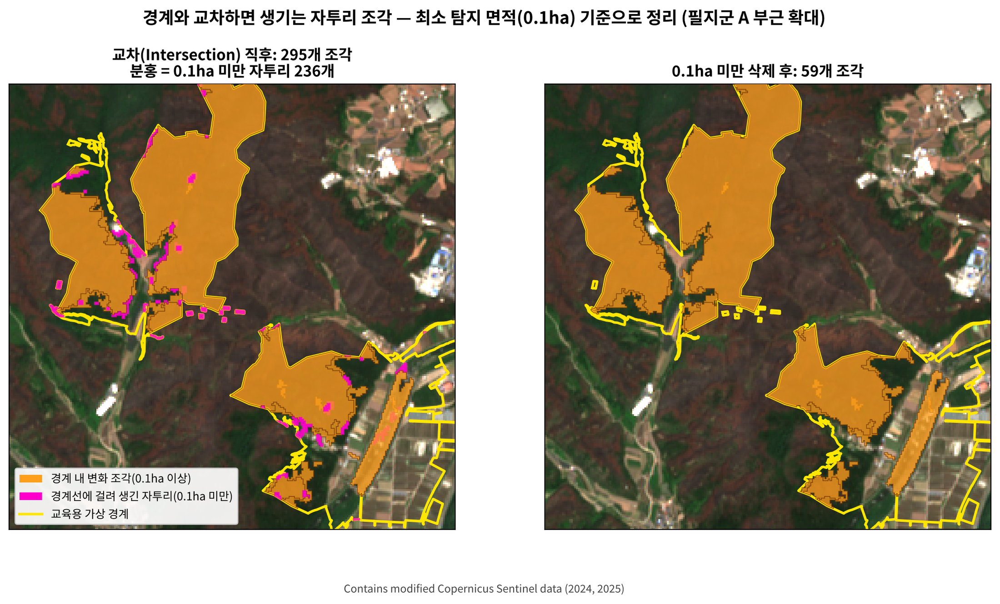

*그림 18. 경계와 교차하면 생기는 자투리(분홍). 실습 2에서 정한 최소 탐지 면적(0.1ha)보다 작은 조각은 같은 기준으로 정리합니다.*

### 3️⃣ 단계 3. 실습 1 판독점 개수 붙이기  `📖 시연`

> 📖 단계 3·4는 강사가 시연합니다(합계 4분). 수강생은 시연이 끝나면 **`03_backup\백업_실습3\후보지_원인결합.gpkg`** 를 불러와 단계 5로 갑니다. 이 파일은 단계 2 결과(59개)에 판독점 개수(`cand_id_count`)와 원인(`cause`, `basis`)을 붙여 둔 것입니다.

내가 눈으로 찾은 지점이 자동 탐지 결과와 겹치는지 확인합니다.

1. 툴박스에서 `Join attributes by location (summary)(위치로 속성 결합 - 요약)` 을 엽니다.
   - `Join to features in(결합 대상 레이어)`: `후보지_정리`
   - `Where the features(공간 조건)`: `contain(포함)` 체크
   - `By comparing to(비교 레이어)`: `후보지_실습1_완성본` (또는 내 `후보지_실습1`)
   - `Fields to summarise(요약할 필드)`: `cand_id`
   - `Summaries to calculate(계산할 요약)`: `count`
   - `Joined layer(출력)`: `forest_rs\output\후보지_판독결합.gpkg`
2. `Run` 후 속성 테이블에 `cand_id_count` 필드가 생겼는지 확인합니다. 1이면 판독점이 그 조각 안에 있다는 뜻이고, 비어 있으면(NULL) 판독점이 없다는 뜻입니다.

### 4️⃣ 단계 4. 원인 판독 결과 붙이기  `📖 시연`


원인 판독(산불인지, 개간인지 등)은 사람이 영상을 보고 하는 일입니다. 시간 관계상 강사가 59개 조각을 판독해 둔 점 레이어를 위치로 결합합니다. 실무에서는 담당자가 직접 판독해 입력합니다.

1. `Layer > Add Layer > Add Vector Layer` 로 `02_vector\원인판독점_강사.gpkg` 를 불러옵니다.
2. 툴박스에서 `Join attributes by location(위치로 속성 결합)` 을 엽니다.
   - `Join to features in`: `후보지_판독결합`
   - `Where the features`: `contain(포함)` 체크
   - `By comparing to`: `원인판독점_강사`
   - `Fields to add(추가할 필드)`: `cause`, `basis` 만 체크
   - `Join type(결합 유형)`: `Take attributes of the first matching feature only (one-to-one)(첫 번째 일치 피처만, 1:1)`
   - `Joined layer`: `forest_rs\output\후보지_원인결합.gpkg`
3. `Run` 후 속성 테이블에서 59개 모두 `cause` 가 채워졌는지 확인합니다.

| cause 값 | 개수(사례지) | 판독 근거 |
|---|---|---|
| 산불추정 | 43 | 불규칙 대면적 감소, 연소지수(dNBR) 평균 0.27 이상 |
| 미상 | 13 | 원인 불명 — 고해상도·현장 확인 필요 |
| 오탐추정 | 2 | 농경지의 소규모 변화(영농 주기 차이 추정) |
| 벌채추정 | 1 | 산림 내 소규모 패치(실습 1 P08) |

### 5️⃣ 단계 5. 현장조사 우선순위 점수 계산  `🎓 수업 10분`

> 🎓 입력 레이어는 불러온 `후보지_원인결합` 입니다. 점수식은 길기 때문에 교재에서 **복사해 붙여넣으십시오.**

**아래 점수 체계는 교육용 예시(가정)입니다.** 실무에서는 기관의 단속·관리 기준에 맞게 항목과 배점을 정합니다.

| 항목 | 기준 | 점수 |
|---|---|---|
| 원인이 이미 설명되는 변화 | `cause` 가 산불추정 또는 오탐추정 | **0점으로 처리**(3순위) |
| 경계 내 면적(`in_ha`) | 1ha 이상 / 0.3~1ha / 0.3ha 미만 | 3 / 2 / 1 |
| 변화 강도(`grade`) | 2(강한 감소) / 1(감소) | 2 / 1 |
| 원인 판독(`cause`) | 개간·시설추정 / 벌채추정·미상 | 3 / 2 |
| 육안 판독 일치(`cand_id_count`) | 1 이상 / 없음 | 1 / 0 |

1. `후보지_원인결합` 속성 테이블 > 필드 계산기
   - 새 필드 `score`, `Whole number (integer)(정수)`
   - 표현식:

```
CASE WHEN "cause" IN ('산불추정','오탐추정') THEN 0
ELSE
    CASE WHEN "in_ha" >= 1 THEN 3 WHEN "in_ha" >= 0.3 THEN 2 ELSE 1 END
  + CASE WHEN "grade" = 2 THEN 2 ELSE 1 END
  + CASE WHEN "cause" IN ('개간추정','시설추정') THEN 3 ELSE 2 END
  + CASE WHEN coalesce("cand_id_count", 0) >= 1 THEN 1 ELSE 0 END
END
```

2. 필드 계산기를 다시 열어
   - 새 필드 `priority`, `Text (string)`
   - 표현식:

```
CASE WHEN "score" >= 7 THEN '1순위'
     WHEN "score" >= 5 THEN '2순위'
     ELSE '3순위' END
```

3. 편집 저장 → 편집 모드 끄기.
4. 레이어 오른쪽 클릭 > `Export > Save Features As` 로 `forest_rs\output\현장조사_후보지.gpkg`(EPSG:5186)에 저장합니다.

📊 **사례지 결과(강사 완성본)**

| 순위 | 개수 | 조각 |
|---|---|---|
| 🔴 1순위 | 1 | C238(필지군 C, 하천변 선형 변화, 6.25ha, 미상, 점수 8) |
| 🟠 2순위 | 3 | C264(필지군 C, 1.10ha·0.30ha 두 조각, 미상), C158(필지군 B, 0.23ha, 벌채추정) |
| ⚪ 3순위 | 55 | 산불추정 43, 오탐추정 2, 그 외 소규모 미상 10 |

🎯 **설계 의도**: 원인이 이미 알려진 대면적 산불은 무단점유 관점의 우선순위가 낮고, **원인을 알 수 없는 직선형·소규모 변화가 위로 올라오도록** 했습니다. 업무 목적이 산불 복구 모니터링이라면 점수 체계를 반대로 설계합니다.

> 💡 판독점 위치나 원인 판독이 달라지면 점수도 달라집니다. 점수는 판단을 돕는 도구이며, 담당자가 조정했다면 그 이유를 기록합니다.

### 6️⃣ 단계 6. 지도 표현  `🎓 수업 3분`


1. `현장조사_후보지` 더블클릭 > `Symbology`
   - 맨 위 `Single Symbol` 을 `Categorized(분류)` 로 변경
   - `Value(값)`: `priority`
   - `Classify(분류)` 클릭
   - 색 칸을 더블클릭해 1순위 빨강, 2순위 주황, 3순위 회색으로 지정 → `OK`
2. `Labels(라벨)` 탭 > `Single Labels(단일 라벨)` > `Value`: `chg_id` > `Buffer(버퍼)` 에서 `Draw text buffer` 체크(흰 테두리) → `OK`
3. 레이어 순서를 위에서부터 `현장조사_후보지`, `교육용_가상국유림`(노란 테두리), `S2_T2_20250605_TCI` 로 맞추고 나머지는 끕니다.

### 7️⃣ 단계 7. 인쇄 조판으로 결과지도 만들기  `📖 시연 5분`

> 📖 강사가 조판 과정을 시연하고 완성본 `03_backup\백업_실습3\결과지도.pdf` 를 보여 줍니다. 결과지도에 들어가야 할 **필수 9요소**만 기억하십시오. 조판은 교육 후 아래 절차로 연습합니다.

1. 메뉴 `Project(프로젝트) > New Print Layout(새 인쇄 조판)` → 이름 `결과지도` 입력 → `OK`.
2. 조판 창의 빈 곳을 오른쪽 클릭 > `Page Properties(페이지 속성)` > 크기 `A4`, 방향 `Landscape(가로)`.
3. 메뉴 `Add Item(항목 추가)` 에서 하나씩 추가합니다. 추가한 뒤 오른쪽 `Item Properties(항목 속성)` 탭에서 설정합니다.

| 항목 | 메뉴 | 설정 |
|---|---|---|
| 지도 | `Add Map(지도 추가)` → 종이 왼쪽 2/3에 드래그 | `Scale(축척)`에 `12500` 처럼 정수 입력 |
| 제목 | `Add Label(레이블 추가)` | "산림 변화 후보지 및 현장조사 우선순위(교육용)", 글자 크기 20 |
| 범례 | `Add Legend(범례 추가)` | `Auto update` 체크 해제 후 필요 없는 레이어를 `−` 로 제거 |
| 축척 막대 | `Add Scale Bar(축척 막대 추가)` | 단위 `Meters`, 구간 500m |
| 방위표 | `Add North Arrow(방위표 추가)` | 지도 오른쪽 위 |
| 표 | `Add Attribute Table(속성 테이블 추가)` | `Layer`: 현장조사_후보지, `Attributes...` 에서 chg_id·bnd_id·priority·in_ha·cause·score만 남기고 `score` 내림차순 정렬, `Maximum rows(최대 행)` 8 |
| 주기 | `Add Label` | 아래 필수 기재사항 붙여넣기 |

🧾 **결과지도 필수 기재사항** (그대로 복사해 레이블에 붙여넣기)

```
분석기간 : T1 2024-05-31 / T2 2025-06-05 (Sentinel-2 L2A, 타일 T52SDF)
분석방법 : NDVI 차분, 임계값 −0.15 / −0.30(교육용 설정), 최소탐지면적 0.1ha(10화소, 8방향)
좌표계   : EPSG:5186 (면적 산출 기준), 영상 원본 EPSG:32652
자료출처 : Contains modified Copernicus Sentinel data (2024, 2025);
           국토교통부 연속지적도(브이월드); 산림청 임상도
유의사항 : 국유림 경계는 교육용 가상 경계임. 본 지도는 현장조사 후보지
           선정용이며 무단점유 등 위법 여부를 판단한 자료가 아님.
작성     : 소속 / 성명 / 작성일
```

> 💡 표의 `Maximum rows` 가 동작하지 않으면 표 항목의 높이를 줄여 위쪽 행만 보이게 하십시오.

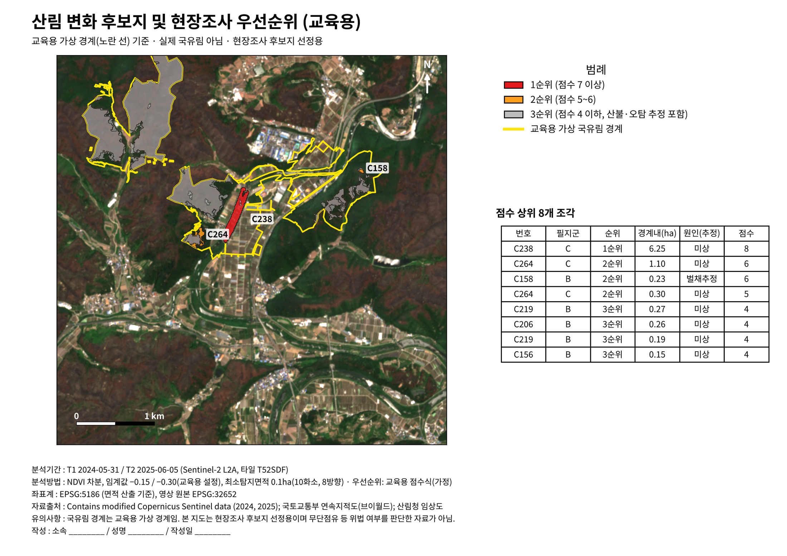

*그림 19. 결과지도 완성 예시(A4 가로). 필수 9요소(제목·범례·축척·방위표·좌표계·분석기간·출처·유의사항·작성자)가 모두 들어 있습니다.*

> 📷 **화면 캡처 자리 S-08** — 인쇄 조판 창에서 지도·범례·표를 배치하고 오른쪽 Item Properties 탭이 보이는 화면

### 8️⃣ 단계 8. 지도와 표 내보내기  `🎓 수업 3분 (XLSX만)`

> 🎓 수업에서는 2~3번(XLSX 내보내기)만 합니다. PDF 내보내기와 GPS 파일 만들기는 📖 자습입니다.

1. 조판 창 메뉴 `Layout(조판) > Export as PDF(PDF로 내보내기)` → `forest_rs\output\결과지도.pdf`. 이미지가 필요하면 `Export as Image(이미지로 내보내기)` 로 PNG(300dpi)를 저장합니다.
2. 지도 창으로 돌아와 `현장조사_후보지` 오른쪽 클릭 > `Export > Save Features As`
   - `Format`: `MS Office Open XML spreadsheet [XLSX]`
   - 파일 이름: `forest_rs\output\현장조사_후보지_목록.xlsx`
   - `OK`
3. 엑셀로 열어 한글과 순위가 제대로 보이는지 확인합니다.

📡 **(선택) GPS 장비용 파일 만들기** — 오전 GPS 실습과 연결

4. 툴박스 `Select by expression(표현식으로 선택)` 이나 도구 막대의 표현식 선택 아이콘으로 `"priority" IN ('1순위','2순위')` 를 선택합니다(4개 선택).
5. 툴박스에서 `Point on surface(표면 위의 점)` 를 엽니다.
   - `Input layer`: `현장조사_후보지`, `Selected features only(선택한 피처만)` 체크
   - 출력: 임시 레이어(`Create temporary layer`)
   - 폴리곤 중심점(Centroids)은 오목한 폴리곤에서 폴리곤 밖에 찍힐 수 있으므로, 항상 폴리곤 안에 찍히는 이 도구를 씁니다.
6. 만들어진 점 레이어의 필드 계산기에서 새 필드 `name`(문자열), 표현식 `"chg_id" || '_' || "bnd_id"` 를 만듭니다. GPS 화면에 이 이름이 표시됩니다.
7. 점 레이어 오른쪽 클릭 > `Export > Save Features As`
   - `Format`: `GPS eXchange Format [GPX]`
   - 파일 이름: `forest_rs\output\현장조사_후보지_1_2순위.gpx`
   - `CRS`: **`EPSG:4326`** (GPX는 위경도만 씁니다)
8. 장비가 GPX 대신 KML·SHP를 요구하면 그 형식으로 저장합니다(오전 GPS 실습 안내 참고).

## 🔎 7.3 결과 검증 방법

| 검증 항목 | 확인 내용 |
|---|---|
| 개수 | 교차 295개 → 정리 59개 → 1순위 1, 2순위 3, 3순위 55 |
| 면적 | `in_ha` 가 `area_ha` 보다 크지 않은가? |
| 원인 결합 | 59개 모두 `cause` 가 채워졌는가? |
| 점수 | 1순위 조각을 T1·T2 자연색에서 봤을 때 먼저 조사할 만한가? |
| 지도 요소 | 제목·범례·축척·방위표·좌표계·분석기간·출처·유의사항·작성자 9개가 모두 있는가? |
| 표 | XLSX에서 한글이 깨지지 않고 순위가 보이는가? |
| GPX | 4점이 EPSG:4326으로 저장되었는가? |
| 완성본 대조 | `03_backup\백업_실습3\현장조사_후보지.gpkg`, `결과지도.pdf` 와 비교 |

## ⚠️ 7.4 흔한 오류와 해결

| 증상 | 원인 | 해결 |
|---|---|---|
| 교차 저장 시 `UNIQUE constraint failed` 오류 | `fid` 필드가 중복됨 | 단계 1에서 유지할 필드를 골라 다시 실행 |
| 교차 결과가 비어 있음 | 두 레이어 좌표계 불일치, 또는 실제로 안 겹침 | 두 레이어 좌표계와 겹침 확인 |
| `cand_id_count` 가 대부분 비어 있음 | 정상(판독점이 있는 조각은 일부) | 점수식의 `coalesce` 가 빈 값을 0으로 처리 |
| `cause` 가 비어 있는 조각이 있음 | 정리 기준(0.1ha)이 달라 조각 모양이 다름 | 단계 2의 표현식 확인, 또는 완성본 사용 |
| CASE 식 오류 | 따옴표 구분 실수 | 필드 이름은 큰따옴표(" "), 문자 값은 작은따옴표(' ') |
| 조판의 지도가 빈 화면 | 지도 범위 미설정 | 지도 항목 속성에서 `Set to map canvas extent(지도 캔버스 범위로 설정)` 버튼 |
| 축척 막대 단위가 도(°) | 프로젝트 좌표계가 위경도 | 프로젝트 좌표계를 EPSG:5186으로 |
| 엑셀 한글 깨짐 | CSV를 엑셀로 바로 연 경우 | XLSX로 내보내기 |
| GPX 저장 오류 | 폴리곤 레이어를 GPX로 저장하려 함 | 점 레이어(단계 8-5 결과)로 저장 |

## 💡 7.5 실무 해석

- 결과지도는 **현장조사 계획서의 첨부도면**으로 쓰기에 알맞습니다. 처분·고발 등 법적 절차의 증거로 쓰려면 현장 사진, 측량, 공부 대조 등 별도 증빙이 필요합니다.
- 사례지 1순위(C238)는 하천변 선형 변화로, 하천 정비 공사일 가능성이 있습니다. 이런 경우 현장조사 전에 해당 시기 공사·정비 계획을 먼저 확인하면 출장을 줄일 수 있습니다.
- 우선순위 점수는 **판단을 돕는 도구**입니다. 현장 접근성, 민원 이력, 계절적 긴급성을 고려해 조정하고 이유를 기록합니다.
- 같은 절차를 매년 같은 계절 영상으로 반복하면 관리구역의 **연차별 변화 이력**이 쌓입니다.

## ✅ 7.6 완료 체크리스트

- [ ] 유지할 필드를 골라 변화후보지와 가상 경계를 교차했다
- [ ] `in_ha` 를 계산하고 0.1ha 미만 자투리를 정리했다(59개)
- [ ] 판독점·원인이 결합된 `후보지_원인결합` 을 불러왔다(결합 과정은 시연으로 확인)
- [ ] `score`, `priority` 를 계산했다(1순위 1, 2순위 3)
- [ ] 결과지도 필수 9요소를 말할 수 있다 (조판·PDF 저장은 자습)
- [ ] 후보지 목록을 XLSX로 저장했다
- [ ] (선택) 1·2순위 점을 EPSG:4326 GPX로 저장했다
- [ ] 결과지도에 "가상 경계"와 "위법 판단 아님"을 적었다


---

# 🏛️ 8장. 산림행정 업무 적용 및 결과 해석

## 🏛️ 8.1 산림행정 표준 분석 절차  `📖 자습`

실습 1~3을 업무 절차로 정리하면 다음과 같습니다. 교육용 제안이며 기관별 업무 규정에 맞게 조정합니다.

| 단계 | 할 일 | 산출물 | QGIS 기능 |
|---|---|---|---|
| ① 질문 정하기 | 대상 구역, 기간, 찾을 변화 유형 결정 | 분석 계획(1쪽) | - |
| ② 자료 고르기 | 해상도·계절·구름 기준으로 영상 선정 | 영상 목록(날짜·제품 이름) | (Copernicus Browser) |
| ③ 눈으로 판독 | 두 시기 비교, 고해상도 교차 확인 | 판독점 레이어 | 레이어 켜고 끄기, 점 편집 |
| ④ 계산으로 추출 | NDVI 차분, 임계값, 최소 면적, 면적 계산 | 변화 후보 폴리곤 | 래스터 계산기, Sieve, Polygonize |
| ⑤ 정리·우선순위 | 경계 중첩, 판독 결합, 점수화 | 후보지 목록·결과지도 | 교차, 위치로 결합, 필드 계산기, 인쇄 조판 |
| ⑥ 현장조사 | GPS로 후보지 방문, 사진·현황 기록 | 현장조사서 | GPX 내보내기 |
| ⑦ 공부 대조 | 소유·지목·허가기록 대조 | 대조 결과 | (내부 시스템) |
| ⑧ 행정 판단 | 무단점유 여부 및 조치 결정 | 조치 문서 | - |
| ⑨ 이력 관리 | 분석 조건과 결과 보관 | 분석 기록 | 프로젝트 파일 저장 |

①~⑤는 위성영상 분석, ⑥~⑧은 행정 영역입니다. **위성영상 분석 결과는 ⑥ 이후를 효율화하는 근거자료**이며 ⑧을 대신하지 않습니다.

## ❓ 8.2 결과를 설명할 때 반드시 밝힐 불확실성  `📖 자습`

| 불확실성 | 내용 | 보고서 표현 예 |
|---|---|---|
| 시기 | 변화 시점은 "두 촬영일 사이"까지만 알 수 있음 | "2024.5.31.~2025.6.5. 사이 발생 추정" |
| 위치 정밀도 | 10m 화소, 경계부 1~2화소 오차 | "경계부 약 10~20m 범위는 위치 불확실" |
| 최소 탐지 면적 | 0.1ha 미만 변화는 탐지 안 됨 | "0.1ha 미만 소규모 변화는 분석 대상에서 제외됨" |
| 임계값 | 기준값에 따라 면적이 크게 달라짐 | "dNDVI −0.15 이하를 감소로 정의(사례지에서 −0.10~−0.40 사이 면적 차이 약 1.7배)" |
| 원인 | 영상은 변화 원인을 알려 주지 않음 | "원인은 현장확인 필요" |
| 오탐 | 구름·그림자·계절·영농 주기 | "자동탐지 결과 중 일부는 오탐일 수 있음" |
| 경계 자료 | 연속지적도·임상도의 위치 정확도 한계 | "경계는 참고용 도면 기준" |

## 🔭 8.3 공개 자료와 고해상도 자료 활용 기준  `📖 자습`

| 상황 | 공개 자료(Sentinel-2, Landsat)로 충분 | 고해상도 영상 필요 |
|---|---|---|
| 대면적 벌채·산불 범위 파악 | ○ | 정밀 경계 확정 시 |
| 관리구역 연간 변화 선별 | ○ | 1·2순위 후보지 정밀 판독 시 |
| 컨테이너·건물·비닐하우스 확인 | × | ○ |
| 폭 5m 이하 진입로 확인 | × | ○ |
| 2015년 이전 변화 시점 추적 | Landsat(30m) 또는 연도별 항공사진 | 항공사진 |
| 법적 절차 증빙 | × (참고자료) | 보조자료(현장 증빙과 함께) |

⚖️ **판단 원칙**: 공개 자료로 **어디를 볼지** 정하고, 고해상도 영상으로 **무엇인지** 확인하며, 현장조사로 **누가, 적법한지** 확인합니다.

## 🧩 8.4 업무 적용 시나리오  `📖 자습`

🧩 **시나리오 A. 관할 국유림 연례 점검**

1. 매년 5~6월 같은 계절 Sentinel-2 영상 2장(전년·당해)을 확보합니다.
2. 실습 2 절차로 변화 후보지를 만듭니다.
3. 관할 국유림 경계(내부 자료)와 교차해 경계 안 후보지만 남깁니다.
4. 기존 허가 구역(사용허가·산지전용 등 내부 자료)과도 교차해 허가 범위 안의 변화를 따로 분리합니다.
5. 허가 범위 밖의 원인 불명 변화를 1순위로 현장조사합니다.

🧩 **시나리오 B. 민원 접수 지점 사실 확인**

1. 민원 위치를 점으로 찍습니다.
2. Copernicus Browser에서 그 지점의 최근 몇 년 영상을 날짜별로 넘겨 보며 변화 시점을 좁힙니다.
3. 국토정보플랫폼 고해상도 영상으로 형태를 확인합니다.
4. 변화 시점과 형태를 현장조사 계획에 반영합니다.

🧩 **시나리오 C. 산불 피해지 복구 모니터링**

1. 피해 직후와 이후 매년 같은 계절 영상으로 NDVI를 계산합니다.
2. 피해 전 NDVI와 비교해 구역별 회복 정도를 봅니다.
3. 회복이 더딘 구역과, 피해 후 생긴 직선형 신규 변화(무단 개간 가능성)를 따로 표시합니다. 이때는 7장 점수식에서 산불 조각을 0점 처리하지 않도록 바꿉니다.

## 🗒️ 8.5 분석 기록 양식  `📖 자습`

결과를 보고하거나 다음 해에 같은 방법으로 반복하려면 아래를 기록합니다.

| 항목 | 사례지 기록 예 |
|---|---|
| 분석 목적 | 교육용 가상 국유림 연례 변화 점검(교육) |
| 영상 | Sentinel-2 L2A, 타일 T52SDF, T1 2024-05-31(기준판 05.10) / T2 2025-06-05(기준판 05.11) |
| 전처리 | 보정값 −1000 반영, SCL 4·5·7 외 제외(두 시기 공통) |
| 지수·임계값 | NDVI, dNDVI ≤ −0.15(감소), ≤ −0.30(강한 감소) |
| 최소 탐지 면적 | 10화소(0.1ha), 8방향 연결(Sieve·폴리곤화 모두) |
| 좌표계 | 영상 EPSG:32652, 면적 EPSG:5186 평면 |
| 경계 자료 | 교육용 가상 경계(실제 국유림 아님) |
| 결과 | 변화 후보 483개 1,026.3ha / 경계 내 59개 / 1순위 1·2순위 3 |
| 검증 | 표본 변화 30·비변화 30 판독(자연색) |
| 분석자·일자 | 소속, 성명, 날짜 |

> 💡 **QGIS 팁**: 작업이 끝나면 `Project > Save As` 로 프로젝트 파일(.qgz)을 저장해 두십시오. 레이어 구성과 색, 조판이 함께 저장되어 다음 해에 영상만 바꿔 같은 지도를 만들 수 있습니다.

---

# ✅ 9장. 실습 최종 점검과 업무 활용 체크리스트

## 🧾 9.1 수강생 실습 결과 점검표  `🎓 수업`

| 번호 | 산출물(`output` 폴더) | 확인 기준 | 완료 |
|---|---|---|---|
| 1 | `후보지_실습1.gpkg` | 의심지점 2~3개, 속성 입력 | ☐ |
| 2 | `NDVI_T1.tif` | 피해 없는 숲 NDVI 0.8 안팎 | ☐ |
| 3 | `dNDVI.tif` | 산불 피해지가 빨간 덩어리로 표시 | ☐ |
| 4 | `변화폴리곤_전체.gpkg` | 8방향으로 폴리곤화 | ☐ |
| 5 | `현장조사_후보지.gpkg` | 59개, `score`·`priority` | ☐ |
| 6 | (자습) `결과지도.pdf` | 필수 9요소 | ☐ |
| 7 | `현장조사_후보지_목록.xlsx` | 한글 정상, 순위 확인 | ☐ |
| 8 | (자습) `현장조사_후보지_1_2순위.gpx` | EPSG:4326, 4점 | ☐ |

## ✅ 9.2 업무 활용 체크리스트  `📖 자습`

🟢 **분석 전**

- [ ] 업무 질문(대상 구역, 기간, 변화 유형)을 한 문장으로 정했다
- [ ] 찾으려는 대상 크기에 맞는 해상도를 골랐다
- [ ] 비교 영상 두 장이 같은 계절이다
- [ ] 관심 지역 안에 구름·그림자·눈이 없거나 제외했다
- [ ] 경계·지적 자료의 기준일과 좌표계를 확인했다
- [ ] 자료의 이용조건과 보안 등급을 확인했다

🟡 **분석 중**

- [ ] Sentinel-2 L2A 보정값(−1000)을 NDVI 식에 반영했다
- [ ] 임계값과 최소 탐지 면적을 정하고 근거를 기록했다
- [ ] Sieve와 폴리곤화의 연결 기준(8방향)을 맞췄다
- [ ] 면적은 투영좌표계(EPSG:5186)에서 계산했다
- [ ] 무작위 표본으로 오탐·누락을 점검했다

🔵 **분석 후**

- [ ] 결과지도에 분석기간·방법·좌표계·출처·유의사항을 적었다
- [ ] 결과를 "무단점유지"가 아닌 "현장확인 대상지"로 표현했다
- [ ] 현장조사·공부 대조·허가기록 확인 계획을 함께 제시했다
- [ ] 프로젝트 파일과 분석 기록을 저장해 다음 해에 반복할 수 있다

---

# 💬 10장. 질의응답과 핵심 내용 정리

## ⭐ 10.1 핵심 내용 7가지  `🎓 수업`

1. **위성영상은 선별 도구다.** 사례지 5km × 5km에서 483개 변화 후보를 찾고, 그중 현장조사 1·2순위는 4개 조각으로 좁혀졌다.
2. **해상도가 탐지 한계를 정한다.** Sentinel-2(10m)는 0.1ha 이상 변화 선별용이며, 시설물 판독에는 고해상도 영상이 필요하다.
3. **같은 계절끼리 비교한다.** 5월과 11월을 비교하자 멀쩡한 숲의 33%가 감소로 잡혔다.
4. **보정값·마스킹·연결 기준·좌표계를 확인한다.** −2000을 빠뜨리면 숲 NDVI가 0.79에서 0.54로, 8방향을 빠뜨리면 폴리곤이 483개에서 1,963개로 바뀐다.
5. **임계값에는 정답이 없다.** 업무 목적에 맞게 정하고 근거를 기록한다.
6. **영상만으로 무단점유를 확정할 수 없다.** 소유·허가·현장·경계 확인이 모두 필요하다.
7. **기록이 곧 재현성이다.** 분석 조건과 프로젝트 파일을 남기면 매년 같은 기준으로 비교할 수 있다.

## 💬 10.2 자주 묻는 질문  `📖 자습`

🙋 **Q1. Sentinel-2로 불법 컨테이너를 찾을 수 있나요?**
10m 화소로는 컨테이너 모양을 판독하기 어렵습니다. 주변 개간이 함께 일어났다면 변화 신호가 잡힐 수 있으나, 확인은 고해상도 영상이나 현장조사로 해야 합니다.

🙋 **Q2. 임계값은 얼마로 해야 하나요?**
정해진 값은 없습니다. 관할 지역에서 확실한 변화·비변화 지점의 dNDVI를 직접 확인하고 정하십시오. 정한 값과 근거를 기록하고 매년 같은 값을 쓰면 연도 간 비교가 됩니다.

🙋 **Q3. 위성분석 면적과 측량 면적이 다릅니다.**
정상입니다. 위성분석 면적은 화소 단위 추정치이며 경계부 오차, 임계값, 최소 탐지 면적에 따라 달라집니다. 공식 면적은 측량 결과를 쓰고, 위성분석 면적은 규모 파악용 참고값으로 씁니다.

🙋 **Q4. 구름이 많은 여름에는 어떻게 하나요?**
5~6월, 9~10월 영상을 먼저 찾아보십시오. 광학 영상이 없으면 구름을 통과하는 레이더(SAR) 영상(예: Sentinel-1)을 쓸 수 있으나 해석 방법이 달라 별도 학습이 필요합니다.

🙋 **Q5. 국유림 경계 자료는 어디서 받나요?**
전국 국유림 경계는 공개 데이터포털에서 파일로 확인되지 않았습니다. 소속 기관의 내부 자료와 업무용 산림공간정보 시스템 제공 여부를 담당 부서에 확인하고, 내부 규정에 따라 쓰십시오.

🙋 **Q6. 매년 같은 작업을 코딩 없이 반복할 수 있나요?**
가능합니다. 이번 실습 프로젝트를 저장해 두고 영상만 바꿔 같은 순서로 하면 됩니다. 익숙해지면 QGIS의 `Processing > Graphical Modeler(그래픽 모델러)` 로 실습 2 단계를 상자와 화살표로 묶어 한 번에 실행할 수도 있습니다(다음 날 QGIS 실습과 연계).

🙋 **Q7. 내 관할 지역 영상을 실습처럼 작게 자르려면?**
`Raster > Extraction > Clip Raster by Mask Layer(마스크 레이어로 래스터 자르기)` 에서 관할 구역 폴리곤을 마스크로 지정하면 됩니다(부록 D.3).

## 📚 10.3 강의 후 자습 과제(선택)  `📖 자습`

1. 소속 관할 구역에서 같은 계절 Sentinel-2 영상 2장을 Copernicus Browser로 찾아본다.
2. 관할 구역 한 곳에서 실습 2 절차를 반복하고, 임계값과 결과를 8.5절 양식으로 기록한다.
3. 1순위 후보지 한 곳을 국토정보플랫폼 고해상도 영상으로 확인한다.

---

# 📖 부록 A. GIS·원격탐사 전문용어집

| 용어 | 영문 | 쉬운 설명 |
|---|---|---|
| 원격탐사 | Remote Sensing | 직접 닿지 않고 멀리서(위성·항공기·드론) 대상을 관측하는 기술 |
| 광학 영상 | Optical Imagery | 햇빛의 반사를 기록한 영상. 구름을 통과하지 못함 |
| 레이더 영상 | SAR | 위성이 쏜 전파의 반사를 기록. 구름·밤에도 촬영 가능 |
| 밴드 | Band | 영상이 기록한 특정 파장대. 사진의 색 채널과 비슷 |
| 반사율 | Reflectance | 지표에 들어온 빛 중 반사된 비율(0~1) |
| 지표반사율 | Surface Reflectance (BOA) | 대기 영향을 제거한 지표면의 반사율 |
| L1C / L2A | Level-1C / Level-2A | Sentinel-2 처리 단계. L2A는 대기보정된 지표반사율 |
| 처리 기준판 | Processing Baseline | 위성 자료 처리 방식의 버전(예: 05.10) |
| 보정값(오프셋) | BOA_ADD_OFFSET | 화소값을 반사율로 바꿀 때 더하는 값(L2A는 −1000) |
| 화소값 | DN (Digital Number) | 영상 파일에 저장된 정수값 |
| 공간해상도 | Spatial Resolution | 한 화소가 나타내는 지상의 크기 |
| 시간해상도 | Temporal Resolution | 같은 지점을 다시 촬영하는 주기 |
| 분광해상도 | Spectral Resolution | 구분해 기록하는 파장대의 수와 폭 |
| 화소 | Pixel | 영상을 이루는 최소 격자 한 칸 |
| 혼합화소 | Mixed Pixel | 한 화소 안에 여러 지물이 섞여 값이 평균된 화소 |
| 근적외선 | NIR | 사람 눈에 보이지 않는 파장. 건강한 식생이 강하게 반사 |
| 단파적외선 | SWIR | 수분·연소 흔적에 민감한 파장 |
| NDVI | Normalized Difference Vegetation Index | 근적외와 적색으로 계산하는 식생 지수(−1~1) |
| dNDVI | Differenced NDVI | 두 시기 NDVI의 차이 |
| NBR / dNBR | Normalized Burn Ratio | 근적외와 단파적외로 계산하는 연소 지수와 그 차이 |
| 임계값 | Threshold | 변화/비변화를 나누는 기준값 |
| 최소 탐지 면적 | MMU (Minimum Mapping Unit) | 결과에 포함할 최소 면적(이 교재는 0.1ha) |
| 장면분류 레이어 | SCL | Sentinel-2 L2A의 화소별 구름·그림자·식생 분류 |
| 마스킹 | Masking | 분석에서 뺄 화소를 가리는 처리 |
| 리샘플링(재배열) | Resampling | 화소 크기·격자를 바꾸며 값을 다시 배치하는 처리 |
| 최근린 | Nearest Neighbour | 가장 가까운 원래 화소값을 그대로 쓰는 재배열 방식(분류 자료용) |
| 체 거르기 | Sieve | 정해진 화소 수보다 작은 조각을 주변 값으로 바꿔 없애는 처리 |
| 4방향 / 8방향 연결 | 4- / 8-connectedness | 상하좌우만 이웃으로 볼지, 대각선까지 이웃으로 볼지의 기준 |
| 폴리곤화 | Polygonize | 래스터를 면(폴리곤) 벡터로 바꾸는 처리 |
| 교차 | Intersection | 두 레이어가 겹치는 부분만 잘라 내는 처리 |
| 위치로 결합 | Join attributes by location | 공간적으로 겹치는 다른 레이어의 속성을 붙이는 처리 |
| 정합 | Co-registration | 서로 다른 영상의 위치를 맞추는 것 |
| 오탐 | False Positive | 변화가 없는데 변화로 잡은 것 |
| 누락 | False Negative | 변화가 있는데 잡지 못한 것 |
| 좌표계 | CRS | 위치를 숫자로 나타내는 기준 |
| EPSG 코드 | EPSG Code | 좌표계 식별 번호(예: 5186, 32652, 4326) |
| UTM | Universal Transverse Mercator | 지구를 경도 6° 구역으로 나눈 투영좌표계(한국 51N·52N) |
| 투영좌표계 | Projected CRS | 평면 좌표(m)로 나타낸 좌표계. 면적·거리 계산에 사용 |
| 래스터 | Raster | 격자(화소)로 된 자료. 위성영상 |
| 벡터 | Vector | 점·선·면으로 된 자료. 경계, 도로 |
| GeoTIFF | GeoTIFF | 좌표 정보를 담은 TIFF 영상 파일 |
| GeoPackage | GeoPackage (.gpkg) | 공간자료를 한 파일에 담는 공개 형식 |
| GPX | GPS Exchange Format | GPS 장비가 읽는 위경도 점·경로 파일 |
| 정사영상 | Orthoimage | 지형과 촬영 각도에 의한 왜곡을 보정한 영상 |
| 연속지적도 | Continuous Cadastral Map | 지적도면을 이어 붙인 참고 도면(법적 경계 아님) |
| 임상도 | Forest Type Map | 수종·영급·경급·수관밀도 등을 나타낸 산림 주제도 |
| 타일 | Tile | Sentinel-2 영상의 배포 단위(100km × 100km 격자) |
| 공간 처리 툴박스 | Processing Toolbox | QGIS 분석 도구를 이름으로 검색해 실행하는 창 |
| 인쇄 조판 | Print Layout | 지도·범례·표를 종이 크기에 배치해 PDF로 내보내는 QGIS 기능 |

---

# 📚 부록 B. 데이터 출처 및 참고문헌

## 🔗 B.1 실습 자료 출처

| 자료 | 내용 |
|---|---|
| Sentinel-2 T1 | S2B_MSIL2A_20240531T021529_N0510_R003_T52SDF_20240531T042042 |
| Sentinel-2 T2 | S2B_MSIL2A_20250605T021529_N0511_R003_T52SDF_20250605T041606 |
| Sentinel-2 T0 | S2B_MSIL2A_20241107T021809_N0511_R003_T52SDF_20241107T040904 |
| 연속지적도 | 국토교통부 브이월드 2D 데이터 API(LP_PA_CBND_BUBUN), 2026-10-15 조회 |
| 임상도 | 산림청 임상도(제5차, 경상북도), 산림공간정보서비스 다운로드 신청 |
| 교육용 가상 국유림, 판독점, 원인 판독 | 강사 작성(교육용 가상·추정 자료) |

## 🌐 B.2 데이터 및 플랫폼

| 자료 | URL |
|---|---|
| Copernicus Browser | https://browser.dataspace.copernicus.eu/ |
| Copernicus Data Space Ecosystem 문서 | https://documentation.dataspace.copernicus.eu/ |
| USGS EarthExplorer | https://earthexplorer.usgs.gov/ |
| QGIS | https://qgis.org/ |
| 국토정보플랫폼(국토지리정보원) | https://map.ngii.go.kr |
| 브이월드(국토교통부) | https://www.vworld.kr |
| 산림공간정보서비스(산림청) | https://map.forest.go.kr |
| 공공데이터포털 – 산림청 임상도 안내 | https://www.data.go.kr/data/3045619/fileData.do |
| 공공데이터포털 – 산림청 휴양림고시구역도 API | https://www.data.go.kr/data/15158977/openapi.do |
| 공공데이터포털 – 지자체 산림보호구역 연속주제도(예: 함양군) | https://www.data.go.kr/data/15159371/fileData.do |

## 📘 B.3 기술 문서

| 내용 | 출처 |
|---|---|
| Sentinel-2 L2A 장면분류(SCL) 클래스 | Sentinel Hub Custom Scripts: https://custom-scripts.sentinel-hub.com/sentinel-2/scene-classification |
| L2A 보정값과 NDVI 계산 | Copernicus Data Space 포럼: https://forum.dataspace.copernicus.eu/t/ndvi-with-radiometric-offset-of-sentinel-2-l2a/5243 |
| 처리 기준판별 반사율 변환식 | ESA STEP 포럼: https://forum.step.esa.int/t/get-sentinel-2-reflectance-values-from-dn-for-mosaicking/44397 |
| QGIS 4.x 장기지원판 일정 | QGIS 블로그(2025.10.7.): https://blog.qgis.org/2025/10/07/update-on-qgis-4-0-release-schedule-and-ltr-plans/ |

## 📰 B.4 보도·정책 자료

| 내용 | 출처 |
|---|---|
| 국토위성지도 웹 서비스 개시(2024.2.) | 국토교통부 보도(스마트시티 종합포털 게재): https://smartcity.go.kr/2024/02/15/우리-동네-최신-위성지도-국토정보플랫폼에서/ |
| 국토위성센터 누리집 개설, 의성 산불 촬영 제공(2025.4.) | 뉴스서울: https://newsseoul.co.kr/news/view/1065583821231446 |
| 2025년 경북 산불 피해면적 관련 보도 | 경북매일(2025.9.11.): https://kbmaeil.com/article/20250911500373 |
| 농림위성(차세대중형위성 4호) 발사 | 파이낸셜뉴스(2026.7.7.): https://www.fnnews.com/news/202607072315009124 , 헤럴드경제(2026.7.7.): https://www.heraldk.com/article/2026070716355465782 |

## 📄 B.5 교육계획

- 산림교육원, 「2026년 제2기 산림공간정보시스템과정 교육계획」

---

# 🎒 부록 C. 수강생 실습 준비 안내

## 🎒 C.1 교육 전 준비

| 항목 | 내용 | 필수 여부 |
|---|---|---|
| 온라인 선수강 | 나라배움터 '산림공간정보 활용실무' 수료 | 필수(교육계획) |
| Copernicus 계정 | https://browser.dataspace.copernicus.eu/ 무료 회원가입 | 선택(사후 자습용) |
| 관심지역 | 본인 관할 구역의 지명 또는 좌표 1곳 메모 | 선택(질의응답·자습용) |

## 💻 C.2 교육 당일 PC

| 항목 | 확인 내용 |
|---|---|
| QGIS | 강사가 미리 설치·버전 확인(3.44 LTR 또는 4.2 LTR) |
| 실습 패키지 | `C:\forest_rs\` 처럼 짧은 영문 경로에 압축 해제 |
| 웹브라우저 | Copernicus Browser, 국토정보플랫폼 접속 가능 |
| 저장 위치 | 모든 결과는 `forest_rs\output\` 에 저장 |

## 📁 C.3 실습 패키지 폴더

```
forest_rs\
 ├ 00_project\   실습_프로젝트.qgz
 ├ 01_image\     S2_T1_20240531_*, S2_T2_20250605_* (B04, B08, TCI, SCL10m), 유효화소마스크.tif
 ├ 02_vector\    AOI, 교육용_가상국유림, 연속지적도_AOI, 임상도_AOI, 후보지_템플릿, 원인판독점_강사
 ├ 03_backup\    백업_실습1, 백업_실습2, 백업_실습3
 ├ 04_extra\     T0(2024-11-07) 영상(심화용)
 ├ output\       (내 결과 저장)
 └ README.txt    자료 출처·좌표계·가상 경계 안내
```

## 🆘 C.4 막혔을 때

1. 해당 실습의 "흔한 오류와 해결" 표를 봅니다.
2. 해결되지 않으면 `03_backup\` 의 같은 단계 완성본을 불러와 다음 단계로 넘어갑니다.
3. 강사·보조강사에게 실습 번호, 단계 번호, 오류 메시지를 알려 주십시오.

---

# 🧑‍🏫 부록 D. 강사용 사전 점검 및 대체 실습 시나리오

## 🧾 D.1 사전 점검 일정

| 시점 | 점검 항목 |
|---|---|
| ~10.16 | 강의자료 제출 |
| ~10.28 | 교육원과 같은 버전 QGIS에서 실습 1~3 화면 조작으로 완주, 시간 측정, 화면 캡처(D.4) |
| ~10.30 | 실습 패키지 교육원 전달, 교육원 PC 사양·QGIS 버전·플러그인 설치 가능 여부 확인 |
| 11.5 오전 | 교육장 PC에서 프로젝트 열기, 래스터 계산기·Sieve·폴리곤화 실행 확인, 인터넷 접속 확인 |

## 🧾 D.2 확인 완료 항목과 남은 항목

| 항목 | 상태 | 내용 |
|---|---|---|
| 사례지·영상 날짜 | ✅ 확정 | 안동시 일직면·남후면, T1 2024-05-31, T2 2025-06-05, T0 2024-11-07 |
| 보정값 | ✅ 확인 | 세 영상 모두 BOA_ADD_OFFSET −1000, QUANTIFICATION_VALUE 10000 |
| 계산식·도구 | ✅ 확인 | QGIS 3.44.12에서 래스터 계산기·Sieve·폴리곤화·추출·재투영·필드 계산기 실행, 별도 계산과 화소 단위 일치 |
| 관측값·임계값·면적 | ✅ 확인 | 교재 5·6장 수치 |
| 우선순위 점수식 | ✅ 확인 | 0.1ha 미만 정리 + 산불·오탐 0점 처리 후 1순위 1, 2순위 3 |
| QGIS 화면 메뉴 위치·한국어 명칭 | ⚠️ **미확인** | 교육원 PC에서 화면으로 따라 하며 확인 |
| `@row_number` 시작값 | ⚠️ **미확인** | 속성 테이블 필드 계산기에서 C001로 시작하는지 확인 |
| 조판 표 `Maximum rows` | ⚠️ **미확인** | 화면 조작에서 정상 동작하는지 확인 |
| 교차 결과 저장(fid 오류) | ⚠️ **미확인** | 유지 필드 선택 방식으로 오류 없이 저장되는지 확인 |
| 원인판독점 결합 | ✅ 확인 | 판독점 59개가 정리된 조각 59개에 하나씩 대응 |
| 국토정보플랫폼 영상비교 | ⚠️ **미확인** | 사례지 P01~P08 위치에서 확인 |
| 레이어 스와이프 플러그인 | ⚠️ **미확인** | 교육원 PC 설치 가능 여부 |
| 임상도·연속지적도 이용조건 | ⚠️ **미확인** | 교육용 배포 가능 여부(산림청·브이월드 약관) |

## ⚙️ D.3 강사 전처리 절차 (화면 조작판)

다른 지역으로 실습 자료를 새로 만들 때의 순서입니다.

1. **영상 내려받기**: Copernicus Browser에서 같은 계절 L2A 두 장면을 내려받아 압축을 풉니다.
2. **관심 지역 자르기**: `Raster > Extraction > Clip Raster by Mask Layer` 에서 `Input layer` 는 밴드 파일(.jp2), `Mask layer` 는 관심 지역 폴리곤, `Match the extent of the clipped raster to the extent of the mask layer` 체크로 B04·B08·TCI·SCL을 각각 자릅니다.
3. **SCL을 10m로 맞추기**: `Raster > Projections > Warp (Reproject)` 에서 `Target CRS` 는 원본과 같게, `Resampling method` 는 **`Nearest Neighbour`**, `Output file resolution in target georeferenced units` 는 `10` 으로 실행합니다.
4. **유효화소마스크 만들기**: 래스터 계산기에서 10m SCL 두 장을 `T1_SCL`, `T2_SCL` 로 이름 바꾼 뒤 다음 식으로 계산합니다.

```
( ("T1_SCL@1" = 4) OR ("T1_SCL@1" = 5) OR ("T1_SCL@1" = 7) )
AND
( ("T2_SCL@1" = 4) OR ("T2_SCL@1" = 5) OR ("T2_SCL@1" = 7) )
```

5. **보정값 확인**: 압축을 푼 SAFE 폴더의 `MTD_MSIL2A.xml` 을 메모장으로 열어 `BOA_ADD_OFFSET` 과 `QUANTIFICATION_VALUE` 를 확인합니다.

## 📷 D.4 화면 캡처 목록

교재의 `[화면 캡처 필요]` 자리에 넣을 화면입니다. 교육원과 같은 버전의 QGIS에서 찍습니다.

| 번호 | 위치 | 찍을 화면 |
|---|---|---|
| S-01 | 실습 자료와 QGIS 기본 사용법 | 실습 프로젝트를 연 QGIS 전체 화면(메뉴·레이어 패널·지도·툴박스·상태 표시줄에 번호) |
| S-02 | 3.2 | Copernicus Browser 검색 패널(L2A, 운량, 기간) |
| S-03 | 3.4 | 국토정보플랫폼 사례지 화면과 영상비교 메뉴 |
| S-04 | 4장 단계 1 | 프로젝트를 연 직후 레이어 패널·지도·EPSG:5186 |
| S-05 | 4장 단계 4 | 점을 찍은 뒤 속성 입력 창(P01 예시) |
| S-06 | 6장 단계 2 | 래스터 계산기(NDVI 식, 출력 경로, Use Selected Layer Extent) |
| S-07 | 6장 단계 9 | 필드 계산기(area_ha 설정) |
| S-08 | 7장 단계 7 | 인쇄 조판 창과 Item Properties |
| (권장) | 6장 단계 6·7 | Sieve와 Polygonize 대화상자의 8방향 체크 위치 |
| (권장) | 7장 단계 1 | Intersection 대화상자의 유지할 필드 선택 창 |

## 🧩 D.5 대체 실습 시나리오

| 상황 | 대체 방안 |
|---|---|
| 인터넷 불가 | 웹 시연(3장, 4장 방법 C)을 강사 화면 캡처로 대체. QGIS 실습은 오프라인 패키지로 정상 진행 |
| 교육원 QGIS 버전이 다름 | 메뉴 대신 툴박스 검색(도구 이름)으로 안내 |
| 래스터 계산기 오류가 많음 | 완성본 NDVI·dNDVI를 불러와 단계 5부터 진행 |
| 실습 2가 늦어짐 | 단계 10 생략, 실습 3 단계 3(판독점 결합)을 생략하고 점수식의 마지막 줄을 빼고 계산 |
| 실습 3이 늦어짐 | 조판은 강사 완성본 PDF로 설명하고 XLSX 내보내기만 진행 |
| 시간 여유 | D.6 심화 진행 |
| 숙련도 격차가 큼 | 숙련자에게 D.6 심화, 비숙련자는 완성본으로 핵심 단계만 |

## 📚 D.6 심화 과제(시간 여유 시 또는 사후 자습)

1. **임계값 바꿔 보기**: 6장 단계 5의 −0.15를 −0.10, −0.20으로 바꿔 면적이 어떻게 달라지는지 그림 11과 비교한다.
2. **임상 정보 붙이기**: 툴박스 `Join attributes by location` 으로 `현장조사_후보지` 에 `임상도_AOI` 의 `FRTP_NM`(임상명)을 붙인다(공간 조건 `intersect`, 결합 유형 `Take attributes of the feature with largest overlap only`). 사례지에서는 소나무림 조각이 가장 많았다.
3. **계절 오탐 체험**: `04_extra` 폴더의 T0(2024-11-07) B04·B08로 NDVI를 계산해 T1과 비교하고, 숲 전체가 감소로 나타나는지 확인한다.
4. **그래픽 모델러**: 실습 2의 단계 2~9를 `Processing > Graphical Modeler` 로 묶어 저장한다.

## 🗒️ D.7 강사 진행 메모

- 각 실습을 시작할 때 "완료 후 결과물"(그림)을 먼저 보여 준다.
- 같은 오류가 3명 이상에게 나면 전체 진행을 멈추고 화면으로 함께 해결한다.
- 결과 공유 때 "무단점유" 대신 "현장확인 대상"이라는 표현을 쓰도록 유도한다.
- 실습 결과물(가상 경계 포함)은 교육 목적 외 사용·외부 공유하지 않도록 안내한다.
